# Looks

Each Glyphnotic filter ships with named looks: presets that set the
character set, the motion settings and the filter's own settings in one go
(`docs/SPEC.md`, Looks). Pick one from the **Look** list at the top of the
filter's properties; changing any setting it controls shows the Look as
**Custom**. A new filter starts on its filter's first look.

The stills below are crops (448×336, at 1:1) of what the plugin draws on
three test stills from `tests/stills/`: Victor (*Cosmos Laundromat*, a face
close-up), *Spring* (high contrast) and the *Sintel* poster (a dark scene),
all © Blender Foundation, CC BY (credits in `tests/stills/ATTRIBUTION.md`).
Each is the plugin's output after 30 frames, at cell scale 1. Glyph art
doesn't survive downscaling, so view them at full size.

To redraw them after a change (debug build, from `tools/reference`):

```powershell
..\..\.venv\Scripts\python run_tuning.py --build ..\..\build_dbg\RelWithDebInfo --only looks
```

## Settings

Every look uses Soften 0.6 px, Hold 25, Settle 0%, Boil 0, Boil spread 20
and Boil linger 2 unless the table says otherwise, and Ink's looks use Ink
lightness 0.92, Saturation 1.4, Gamma 0.85, Shape 0.35 and Auto levels
(Adapt speed 1.5 s).

| Filter | Look | Characters | Settings |
| --- | --- | --- | --- |
| Ink | **Black** | ASCII | Cell ink, black background |
| Ink | **Tint** | ASCII | Cell ink, tint background |
| Ink | **Phosphor** | ASCII | Green ink, black background |
| Ink | **Amber** | ASCII | Amber ink, black background |
| Ink | **Every Glyph** | Every glyph | Cell ink, black background |
| Ink | **Static** | ASCII | Green ink, black background, Boil 15, spread 20, linger 2 |
| Ink | **Fever** | ASCII | Cell ink, tint background, Hold 10, Boil 45, spread 35, linger 1, Settle 30% |
| Mosaic | **Blocks** | Blocks | (defaults) |
| Poster | **Poster** | Lines | Levels 6 |
| Console | **Console** | Lines | VGA palette |

## What Phase 4 changed

**Hold 10 → 25 for Blocks, Poster and Console**, the same as Ink's looks.
The pictures on a still are unchanged (Hold acts only over time, so before
and after stills would be identical); what changes is how they hold up on a
noisy camera. Share of cells that change glyph per frame on Victor with
fresh Gaussian noise on every frame (150 frames):

| Look | Noise σ 2/255, Hold 10 → 25 | Noise σ 4/255, Hold 10 → 25 |
| --- | --- | --- |
| Blocks | 0.08% → 0.01% | 0.37% → 0.11% |
| Poster | 0.12% → 0.01% | 1.11% → 0.14% |
| Console | 0.08% → 0.01% | 0.40% → 0.11% |

At Hold 10 a noisier camera (σ 4/255) left Poster twinkling in about one
cell in a hundred every frame; at 25 every look stays at or under 0.14%.
The cost is a little lag on real motion: on Victor panning 1 px per frame,
Poster changes 8.6% of cells per frame at Hold 25 against 12.1% at Hold 10,
and catches up on bigger moves. Fever keeps Hold 10, since it boils by
design.

Every other setting of every look stayed as it was: the sweeps in
`docs/build-history/phase-4.md` found the defaults inside the useful span
of every slider. The looks' Ink settings sit where they are for these
reasons: Gamma 0.85 puts 12–18% of cells on the densest glyphs and under 1%
on space; Shape 0.35 gets most of the glyph-fit gain (it rises
steeply from 0 to about 0.2, then levels off) before the tone error grows;
Saturation 1.4 is well inside the span where every step adds visible color.

## Ink

**Black**: the picture's own colors, lit in characters chosen by
brightness and shape, on black.

| Victor | Spring | Sintel |
| --- | --- | --- |
| 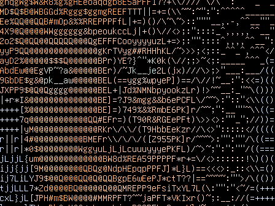 | 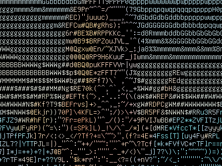 | 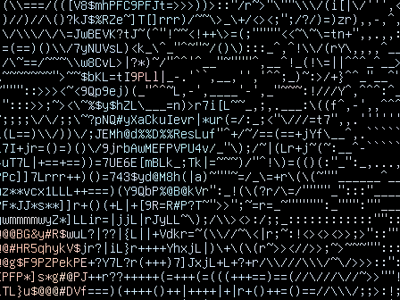 |

**Tint**: as Black, on a background of each cell's own color at 60% of its
lightness, so the picture reads from a distance.

| Victor | Spring | Sintel |
| --- | --- | --- |
| 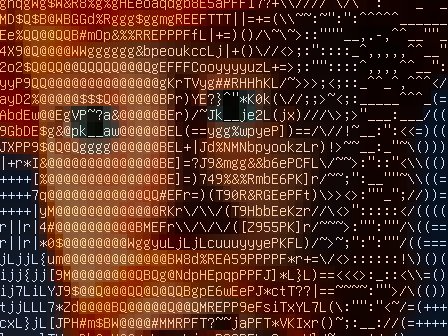 | 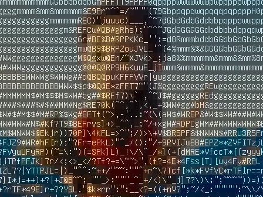 | 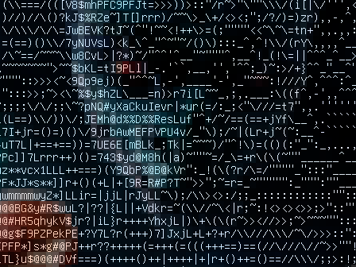 |

**Phosphor**: green terminal ink.

| Victor | Spring | Sintel |
| --- | --- | --- |
| 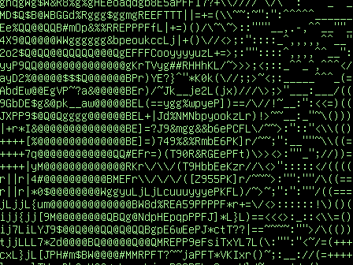 | 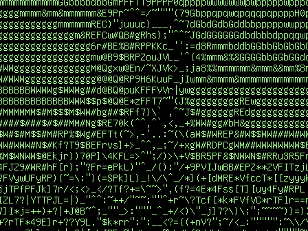 |  |

**Amber**: amber terminal ink (the hue of #FFB000).

| Victor | Spring | Sintel |
| --- | --- | --- |
| 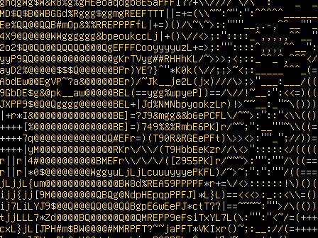 | 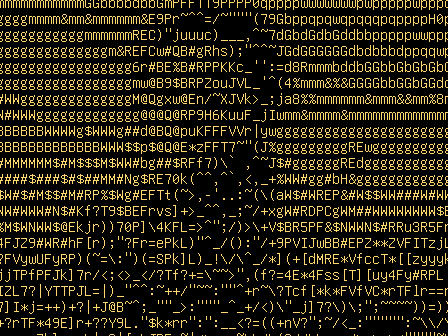 | 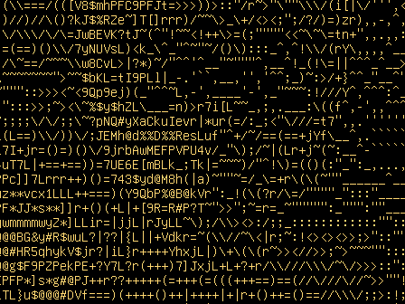 |

**Every Glyph**: all 503 glyphs of the font. With the full block and the
shade characters in the set, smooth bright areas draw as solid blocks of
ink and only detailed areas break into characters: a chunkier, more
graphic look than ASCII. That follows from Ink's brightness-first scoring;
Phase 4 tried Gamma 0.85–1.4 and Shape 0–0.6 and none of them changed the
character of the look, so its settings stayed as they were.

| Victor | Spring | Sintel |
| --- | --- | --- |
| 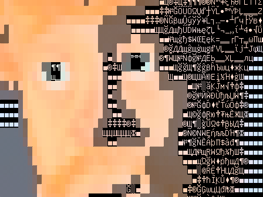 | 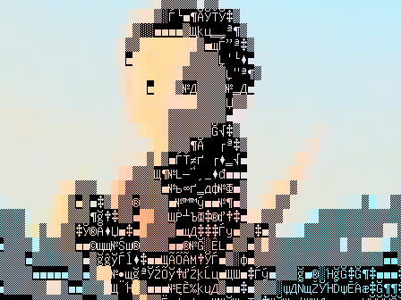 | 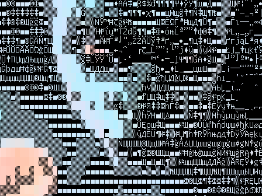 |

**Static**: Phosphor with a light boil: about 0.6 glyph swaps per cell per
second, each two frames long, among glyphs close to the best. The stills
catch one frame of it.

| Victor | Spring | Sintel |
| --- | --- | --- |
| 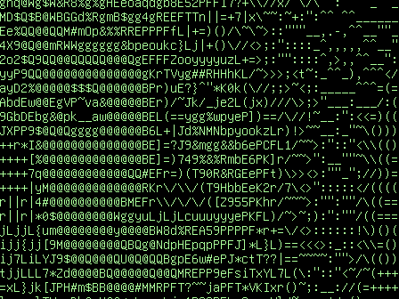 | 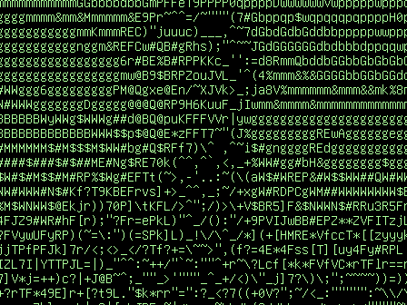 | 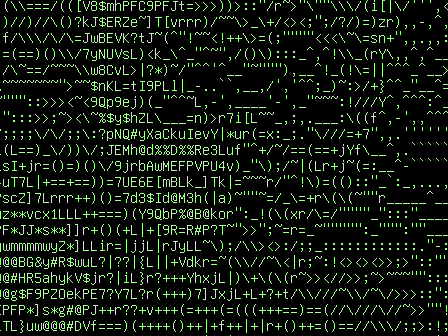 |

**Fever**: Tint with a heavy, one-frame boil (1.8 swaps per cell per
second, wider spread) and colors that trail by 30% per frame.

| Victor | Spring | Sintel |
| --- | --- | --- |
|  |  | 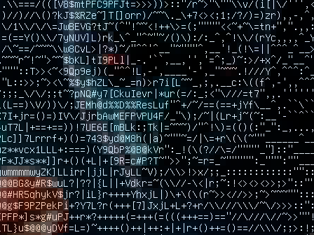 |

## Mosaic

**Blocks**: block characters, each cell with free text and background
colors.

| Victor | Spring | Sintel |
| --- | --- | --- |
| 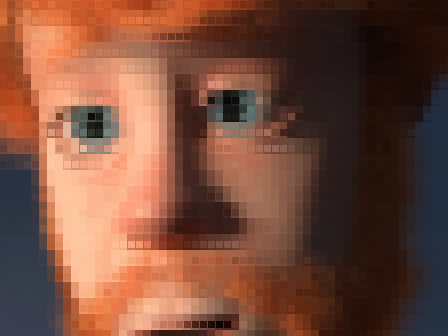 | 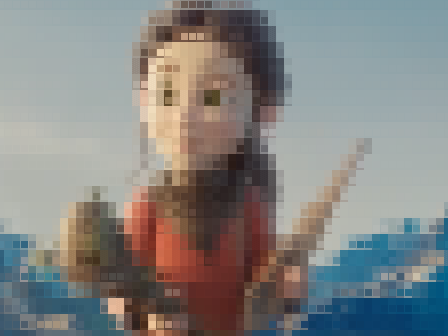 | 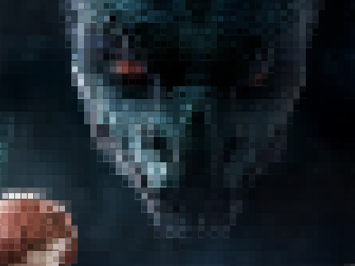 |

## Poster

**Poster**: Mosaic with the Lines set, colors snapped to 6 levels per
channel.

| Victor | Spring | Sintel |
| --- | --- | --- |
| 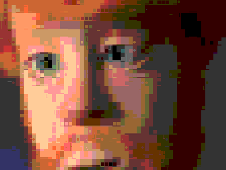 | 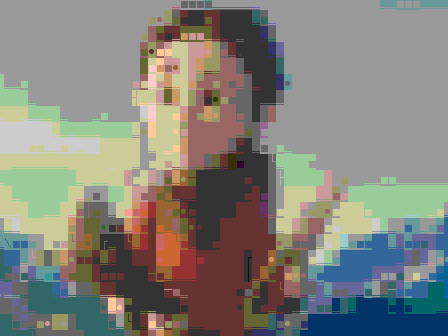 | 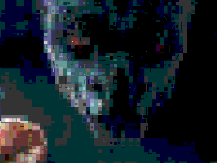 |

## Console

**Console**: the Lines set in the 16-color VGA text-mode palette, with
backgrounds from its eight normal-intensity colors. **Capture palette**
fits the 16 colors to the scene instead.

| Victor | Spring | Sintel |
| --- | --- | --- |
| 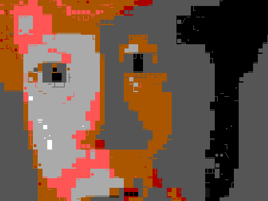 | 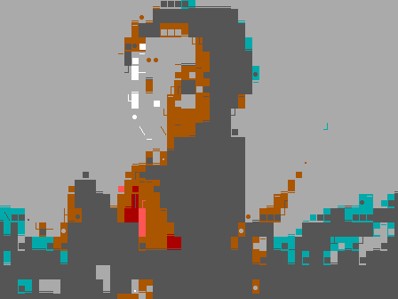 | 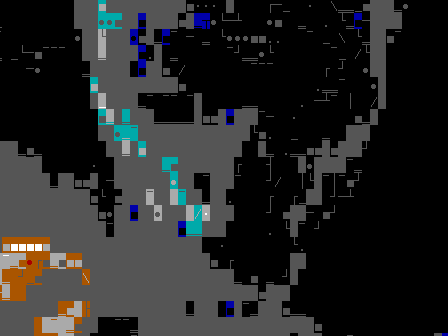 |
