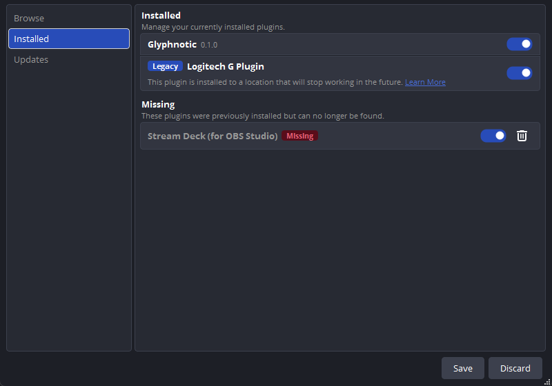

# Phase 0: scaffold

Date: 2026-11-11. Plugin version 0.1.0. Built against OBS Studio 33.0.1.

## Acceptance

| Item | Result |
| --- | --- |
| Repository created from `obsproject/obs-plugintemplate`; CI builds Windows, Linux and macOS packages | **Done** for Windows and Linux. Created from the template at commit `3e7d7ac3` (2025-12-09) and moved to OBS 33. CI on `main` ([run 42989070374](https://github.com/donliggett/glyphnotic/actions/runs/42989070374), commit `46ae933`) passed: format checks, Windows (zip) and Ubuntu 26.04 (.deb, tarball, .ddeb, source), unit tests on both. macOS builds only on tags and manual runs (agreed at review) and hasn't run yet. |
| Pass-through "Glyphnotic Ink" loads in OBS 33 from the new plugin location, with no "Legacy" badge | **Done.** Windows: OBS 33.0.1, Plugin Manager checked. Linux: OBS 33.0.0 under Xvfb, from both the .deb and the per-user tarball. |
| PSF1 parser and character sets, with unit tests confirming 5 / 25 / 95 / 503 | **Done.** 41 checks pass with MSVC 14.51, MinGW GCC 13.2, and GCC 15.2 on Ubuntu 26.04. |
| Install paths confirmed and written into Install and `docs/INSTALL.md` | **Done.** From OBS 33.0.1's source and OBS's documentation; tested on Windows and Linux. |

Review changes (2026-11-11, after the first review): macOS CI only on tags
and manual runs; the font ships uncompressed and the gzip code (and vendored
`puff`) is gone; Linux load test under Xvfb; the template's `build-aux/run-*`
symlinks restored; README license line; `data/manifest.json` in the spec's
layout and the OBS minimum pinned at 33.0.0.

## What was built

- **Template, moved to OBS 33.** The template still targeted OBS 31.1.1.
  Changes, all following what OBS 33.0.1's own build uses:
  - `buildspec.json`: obs-studio 33.0.1, obs-deps and Qt6 2026-10-23 (hashes
    from OBS's `CMakePresets.json`; the source-archive hashes were computed
    from GitHub's 33.0.1 archives). Name `glyphnotic`, display name
    Glyphnotic, version 0.1.0.
  - `CMakePresets.json`: Visual Studio 18 2026 generator, Windows SDK
    10.0.26100.0, macOS deployment target 13.0.
  - CI runners: `ubuntu-26.04`, `macos-26` with Xcode 26.5,
    `windows-2025-vs2026`. OBS's PPA has 33.0.0 for Ubuntu 26.04 ("resolute").
  - Install rules (`cmake/windows/helpers.cmake`, `cmake/linux/helpers.cmake`)
    now use OBS 33's layouts. macOS was already right: the .pkg installs the
    bundle into the current user's `~/Library/Application Support/obs-studio/plugins/`.
  - Linux packaging: the .deb is named `glyphnotic-<version>-linux-x86_64.deb`
    and depends on `obs-studio (>= 33.0.0)`; a per-user tarball
    `glyphnotic-<version>-linux-x86_64.tar.xz` (`glyphnotic/glyphnotic.so`,
    `glyphnotic/data/`) is always made. CI upload globs follow the new names.
  - A unit-test step in each CI job. Windows and Linux build on every push to
    `main` and on pull requests; macOS only for tags and manual runs.
  - `data/manifest.json` is generated from `buildspec.json`. OBS 33's Plugin
    Manager reads it for the display name, ID and version (found in
    `libobs/obs-module.c`, `obs_module_load_metadata`).
- **`src/plugin-main.cpp`** loads the font from the module's data folder,
  logs the set sizes, and registers the Ink filter.
- **`src/glyph-filter.cpp`**: one implementation registered per mode through
  `type_data`. In Phase 0 only Ink is registered, and `video_render` calls
  `obs_source_skip_video_filter`, so it passes the picture through. Source IDs
  are fixed now because scene files save them: `glyphnotic_ink`,
  `glyphnotic_mosaic`, `glyphnotic_poster`, `glyphnotic_console`.
- **`src/font.cpp`** (no libobs dependency): PSF1 parsing per the spec, the five character sets,
  and the atlas texel layout (one row per glyph, 128 texels, row-major 8×16).
  Uploading the atlas to a texture is Phase 1.
- **`data/fonts/Uni2-Fixed16.psf`**: Debian 13's
  `console-setup-linux_1.242~deb13u1_all.deb` ships it as
  `Uni2-Fixed16.psf.gz`; it's committed decompressed, with no other change.
  The README gives its origin, public-domain status, and the SHA-256 of both
  the source `.psf.gz` and the `.psf`.
- **`tests/unit/`**: a standalone CMake project (`font-test`) needing only a
  compiler.
- **Docs**: `docs/INSTALL.md`, `docs/BUILDING.md`, a project `README.md`,
  and this report.

## How it was tested

### Character sets

Before writing the C++, a throwaway Python script parsed the font on its own
and got the same counts: 512 glyphs, 791 mapped code points, and sets of 5,
25, 95 and 503 unique glyphs. So the spec's numbers match the real font.

`font-test` (41 checks) confirms:

- the font has 512 glyphs; space has 0 lit pixels and U+2588 has 128;
- Blocks 5, Lines 25, ASCII 95, Every glyph 503;
- every set starts with space, and no two entries share a bitmap;
- Lines starts with the Blocks set; Every glyph is in code-point order and
  skips U+0000–U+0020 and U+007F–U+009F;
- Custom keeps typed order, drops duplicates and missing characters, decodes
  UTF-8, and a set of only space isn't usable;
- the atlas matches the bitmaps texel by texel;
- bad input (wrong magic, truncation, no Unicode table, a missing file,
  malformed UTF-8) is rejected.

Built and passed with MSVC 14.51 (`/W4 /WX`) and MinGW GCC 13.2
(`-Wall -Wextra -Werror`).

Which characters collapse: in Blocks, U+25AE ▮ has the same bitmap as
U+25A0 ■. In Lines, the double and rounded box characters (═ ║ ╭ ╮ ╰ ╯) are
drawn the same as their single-line forms, ● matches •, and `/` and `\`
match ╱ and ╲.

### Loading in OBS 33 (Windows)

Machine: Windows 11 Pro 25H2, OBS 33.0.1 (installer build), Visual Studio
2026 Build Tools 18 (MSVC 14.51), CMake 4.2.3. The plugin was built with the
`windows-x64` preset (warnings as errors, the template's default) and
installed into `C:\ProgramData\obs-studio\plugins\glyphnotic\`
(`glyphnotic.dll`, `glyphnotic.pdb`, `data\`).

OBS log:

```
OBS 33.0.1 (64-bit, windows)
[glyphnotic] font loaded: 512 glyphs; sets Blocks 5, Lines 25, ASCII 95, Every glyph 503
[glyphnotic] plugin loaded successfully (version 0.1.0)
  Loaded Modules:
    glyphnotic.dll
[glyphnotic] plugin unloaded
Number of memory leaks: 0
```

OBS's `plugin_manager/modules.json` recorded display name Glyphnotic, ID
`glyphnotic`, version 0.1.0, and source `glyphnotic_ink`.

**Tools → Plugin Manager** shows Glyphnotic 0.1.0 without a Legacy badge. The
Logitech G plugin on the same machine, installed in a legacy location, shows
one, which confirms the badge would appear if it applied:



This also follows from OBS's source: the only ProgramData loader that marks
modules as legacy looks in `<plugin>\bin\64bit\`, which Glyphnotic doesn't
have.

Not yet tested by hand: adding the filter to a source (it would change the
scene collection on this machine). The filter is registered (it's in
`modules.json`), and it only calls `obs_source_skip_video_filter`.

### Linux (Ubuntu 26.04 container)

An `ubuntu:26.04` Docker container ran what the CI job runs:
`.github/scripts/build-ubuntu` (installs OBS 33.0.0 and its build
dependencies from OBS's PPA, builds with the `ubuntu-ci-x86_64` preset,
warnings as errors) and `.github/scripts/package-ubuntu --package`, plus the
unit tests. The compiler was GCC 15.2. Everything succeeded:

- unit tests: passed;
- `glyphnotic-0.1.0-linux-x86_64.deb` (26 KB) with
  `/usr/lib/x86_64-linux-gnu/obs-modules/plugins/glyphnotic.so` and
  `/usr/share/obs/obs-modules/plugins/glyphnotic/` (fonts, locale,
  `manifest.json`). Depends: `obs-studio (>= 33.0.0)`, libc6, libgcc-s1,
  libstdc++6;
- `glyphnotic-0.1.0-linux-x86_64-dbgsym.ddeb` and `glyphnotic-0.1.0-source.tar.xz`;
- `glyphnotic-0.1.0-linux-x86_64.tar.xz` holding `glyphnotic/glyphnotic.so`
  and `glyphnotic/data/...`;
- `apt install ./glyphnotic-0.1.0-linux-x86_64.deb` installed the files to
  the paths above.

**Load test under Xvfb.** In a second container run, OBS 33.0.0 from OBS's PPA
was started as an ordinary user with
`timeout -s INT 45 xvfb-run -a -s '-screen 0 1920x1080x24' obs --disable-shutdown-check --disable-updater`,
rendering through Mesa llvmpipe (OpenGL 4.5 core). It ran twice: once with
the .deb installed (system location), and once with the .deb removed and
the tarball extracted into `~/.local/share/obs-studio/plugins/` (per-user
location). Both logs show:

```
OBS 33.0.0 (linux)
Loading up OpenGL on adapter Mesa llvmpipe (LLVM 21.1.8, 256 bits)
[glyphnotic] font loaded: 512 glyphs; sets Blocks 5, Lines 25, ASCII 95, Every glyph 503
[glyphnotic] plugin loaded successfully (version 0.1.0)
  Loaded Modules:
    glyphnotic.so
```

and `plugin_manager/modules.json` lists ID `glyphnotic`, version 0.1.0, source
`glyphnotic_ink`. Both locations are ones OBS 33 loads as non-legacy (OBS's
Linux loader marks only `obs-plugins/` and `~/.config/.../bin/64bit/` as
legacy). The Plugin Manager window itself wasn't inspected on Linux, and OBS
was stopped by the timeout, so the log has no shutdown or leak count. The
other "Failed to initialize" lines are OBS's AJA, DeckLink and NVENC modules,
which have no hardware in the container.

Two small things for Phase 5 packaging: the tarball's `.so` isn't stripped
(211 KB against 26 KB for the .deb, whose debug info goes into the .ddeb),
and the .deb's Depends lists `obs-studio` a second time (added by
dpkg-shlibdeps), which is harmless. Data files in this container build were
mode 755 only because the repository was mounted from Windows.

### Formatting

CI's format check runs clang-format 19 and gersemi 0.21.0 (the versions in
OBS's Homebrew tap). On a first push it checks every file. With those exact
versions, every C/C++ and CMake file in the repository passes.

### macOS

Not built. The macOS CI job is the template's, with the runner, Xcode and
deployment target updated. It runs only for tags and manual runs, so it will
first run with the first tag or a manual dispatch.

### CI

The first two pushes failed on Ubuntu only. GitHub's `ubuntu-26.04` runner
uses Ubuntu's amd64v3 package variant. In that mode apt reads only the
PPA's amd64v3 index, which is empty, so it installed Ubuntu's own
obs-studio 32.1.0, which has no libobs CMake package, and configure failed.
An apt pin didn't help, since the PPA's package wasn't visible at all. The
fix, reproduced and checked first in an `ubuntu:26.04` container with
`APT::Architecture-Variants "amd64v3"`, adds `Architectures: amd64` to the
PPA's deb822 source in `.github/scripts/utils.zsh/setup_ubuntu`. The script
also stops if the installed OBS is older than 33.0.0. The third run
([42989070374](https://github.com/donliggett/glyphnotic/actions/runs/42989070374))
installed obs-studio 33.0.0 from the PPA and passed.

### Docker

The Linux checks ran in Docker Desktop (WSL 2 backend), whose data lives in
`%LOCALAPPDATA%\Docker\wsl\disk\docker_data.vhdx` (17.6 GB on this machine,
shared with other projects). Glyphnotic added only the `ubuntu:26.04` image
(`6a06111c3b0a`, 163 MB on disk). Both runs used `docker run --rm`, so no
containers or volumes were left. After the tests the image was removed with
`docker rmi ubuntu:26.04`. The VHDX doesn't shrink by itself when images are
removed; Docker Desktop reclaims the space over time or on demand
(Troubleshoot → Clean / Purge data affects all projects, so it was left alone).

## Deviations from the spec, with reasons

- **macOS in CI only for tags and manual runs**, so the first box was ticked
  on Windows and Linux CI alone (as agreed at review).
- **CI setup script changed beyond the template** to make apt see OBS's PPA
  on amd64v3 runners (see CI above).
- **The font ships uncompressed** (`Uni2-Fixed16.psf`, 10,804 bytes) rather
  than as the spec's `.psf.gz`, so no gzip code is needed. The spec's Font
  section now names the `.psf`.
- **`tests/unit/` added** to the repository layout for the unit tests.
- **Template `LICENSE` moved** to `docs/licenses/obs-plugintemplate-GPL-2.0.txt`
  so that a root `LICENSE` doesn't read as the license decision. Recorded in
  Licensing.
- **macOS package name** is still the template's
  `glyphnotic-<version>-macos-universal.pkg`, not `glyphnotic-<version>-macos.pkg`.
  Renaming it is left to Phase 5 packaging.
- **No Windows installer yet.** The zip is produced; the installer is Phase 5.
- **`build-aux/run-*` are symlinks in the template.** Copying the template on
  Windows turned them into copies of `.run-format.zsh`. They were committed
  as symlinks (git mode 120000) pointing at `.run-format.zsh`, as in the
  template. On a Windows checkout without symlink support they appear as
  small text files.

## Spec updates made

- Platforms: minimum OBS 33.0.0 (built against 33.0.x headers; libobs
  ignores the patch number); macOS built only on tags and manual runs.
- Architecture: toolchain minimums and CI runners for OBS 33.
- Repository layout: `tests/unit/`, `data/manifest.json` (generated),
  `cmake/common/manifest.json.in`, `docs/licenses/`.
- Font: the uncompressed `Uni2-Fixed16.psf`.
- Install: the confirmed paths per platform.
- Licensing: the template's license terms.
- Phase 0 boxes ticked.
