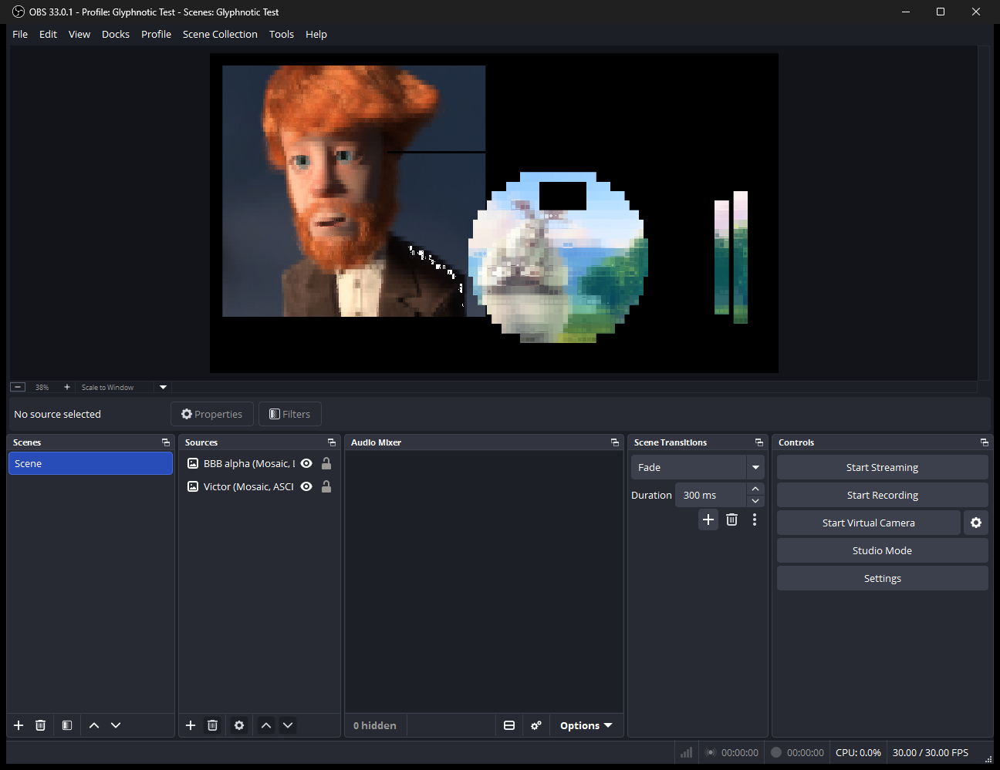

# Phase 1: grid and Mosaic

Date: 2026-11-11. Plugin version 0.1.0. Built against OBS Studio 33.0.1.

Review changes (2026-11-11, after the first review): a Python environment of
Glyphnotic's own with pinned requirements, set-up steps for Windows and
Linux, and the matrix re-run on it; a rough 1080p60 performance check; harness
cases for the no-`OBS_SOURCE_SRGB` decision (Color Correction before and
after, a 10-bit Rec. 709 canvas, an HDR canvas, 16-bit and HDR sources); the
check in the OBS window; a note in the properties when a Custom set falls
back to Blocks; the stale `Uni2-Fixed16.psf.gz` removed from the test
install; and the To try and Open questions sections below.

## Acceptance

| Item | Result |
| --- | --- |
| Sample, Cell stats, Score and Draw passes; Mosaic filter; cell scale; alignment; edges; transparency | **Done.** "Glyphnotic Mosaic" (`glyphnotic_mosaic`) is registered and draws the grid. All four cell scales, both alignments, both edge fills and Keep transparency on and off are covered by the test cases below. |
| sRGB handling: a test still with known patch colors yields cell colors within 1/255 of expected | **Done.** On `patches.png`, every flat cell's text and background colors are within **0.003/255** of the patch's sRGB value, at every cell scale and on a scene. The output frames OBS produced match the expected pixels exactly (no channel off by more than 1). |
| Reference match: ≥ 99% of cells match; every mismatch has a cost gap under 1e-4 | **Done.** **100%** of cells match in all 25 cases (159,865 cells), on both Direct3D 11 and OpenGL, so there are no mismatches to measure a gap for. |

## What was built

- **Render passes** (`data/effects/`), as in the spec's Render passes:
  - `sample.effect`: filter input → OKLab + alpha at `cellsX×8` by
    `cellsY×16`; at cell scale `s`, the alpha-weighted mean of each `s×s`
    block in linear RGB.
  - `stats.effect`: per cell, the mean OKLab of counted samples and the mean
    alpha.
  - `score.effect`: per cell, every glyph's Mosaic cost; output held glyph,
    shown glyph, boil frames left (0) and best cost.
  - `cell-color.effect`: text and background OKLab for the shown glyph, in
    one pass into a double-width target (even texels text, odd texels
    background); alpha marks the cell opaque or transparent.
  - `draw.effect`: the grid at source size into OBS's target, glyphs
    nearest-neighbor at the cell scale, with the edge fill outside the grid.
  - `common.effect` (sRGB and OKLab conversions, vertex shader) and
    `cells.effect` (sample loading, counted-sample weights) are shared
    includes.
- **`src/glyph-filter.cpp`**: the filter core. Effects and four
  `GS_RGBA32F` texrenders per instance; the glyph atlas is a `GS_R8` texture
  (128 × glyph count), rebuilt on the graphics thread when the character set
  changes. Settings: Set (Blocks / Lines / ASCII / Every glyph / Custom),
  Custom characters (shown only for Custom) with a warning note when they
  give fewer than 2 glyphs and Blocks is used, Cell scale (1×–4×), Alignment
  (Center / Top-left), Edges (Black / Transparent), Keep transparency.
  Setting keys are `charset`, `custom_chars`, `cell_scale`, `alignment`,
  `edges`, `keep_transparency`; their values are strings except the scale
  (int) and the checkbox, and they're saved in scene files, so they're fixed
  now. `video_get_color_space` reports SDR sRGB.
- **`src/grid.hpp`**: grid geometry, with `tests/unit/grid-test.cpp`
  (1920×1080 → 240×67 cells with 4 rows left at top and bottom, every scale,
  odd sizes, sources smaller than a cell).
- **`src/plugin-main.cpp`** registers Ink and Mosaic. Ink still passes the
  picture through until Phase 2.
- **Debug tools** (CMake option `GLYPHNOTIC_DEBUG_TOOLS`, off by default):
  the **Dump grid (debug)** button, and `tools/harness`, a headless libobs
  runner. See `tools/README.md`.
- **Reference implementation** (`tools/reference/`): `reference.py`
  (Sample, Cell stats, Score and Mosaic colors in NumPy float64, with its own
  PSF1 parser and character sets), `compare.py`, `run_stills.py`,
  `run_color_paths.py`, `make_stills.py` and `imageio_min.py` (PNG/PAM/BMP
  with only NumPy). `requirements.txt` pins NumPy 2.5.4; the scripts run in a
  `.venv` of Glyphnotic's own at the repository root (git-ignored), set up as
  `tools/README.md` describes for Windows and Linux.
- **Test stills** (`tests/stills/`, 4.7 MB): a generated patch still and
  four Blender Foundation stills (CC BY / CC0), one with a generated alpha
  channel. `ATTRIBUTION.md` credits them and records every change.

## How it was tested

### The harness

The reference comparison needs the plugin to render a known still and hand
back what it drew. Rather than drive the OBS window, `glyphnotic-harness`
runs libobs headless with OBS's own renderer modules and image source, from
the installed OBS 33.0.1:

1. starts libobs with a canvas the size of the still, output format BGRA;
2. loads `image-source` and the plugin (data from the repository's `data/`);
3. puts the filter on the image source, or on a scene holding it
   (`--on-scene`, which takes OBS's other filter input path: a custom-drawn
   parent);
4. after 5 frames presses Dump grid, then saves an output frame from OBS's
   raw video output, the same frames an encoder would get;
5. shuts down and prints libobs's leak count.

It never touches OBS's configuration or scene collections.

### The comparison

`compare.py` runs the reference with the dump's settings and checks:

- the character set (as code points) and the grid geometry match;
- glyph match share and, for mismatches, the cost gap (the reference's cost
  of the plugin's glyph minus its best cost);
- every cell's text and background colors against the reference's colors
  for the plugin's glyph, in sRGB 0–255;
- flat cells (all source pixels one color) against that color, and that
  they pick space;
- each cell's opacity;
- the output frame against the picture the dump describes (glyph bitmaps at
  the cell scale, colors rounded to 8 bits, transparent cells, edge fill),
  allowing 1/255 per channel.

### Results

25 cases over 5 stills: every character set, every cell scale, both
alignments, both edge fills, Keep transparency on and off, a Custom set
(`@#%*+=-:.`), and the filter on a scene. Machine: Windows 11 Pro 25H2,
NVIDIA GeForce RTX 4070 Ti (driver 32.0.16.2101), OBS 33.0.1, MSVC 14.51,
CMake 4.2.3. All 25 pass on both renderers; each run (all 25 cases) takes
about 30 s.

| Case | Cells | Glyphs | Match | Max color error (/255) | Bad frame pixels | Leaks |
| --- | --- | --- | --- | --- | --- | --- |
| patches, Blocks, 1× | 16080 | 5 | 100% | 0.003 | 0 | 0 |
| patches, ASCII, 2×, top-left, transparent edges | 3960 | 95 | 100% | 0.003 | 0 | 0 |
| patches, Lines, 3× | 1760 | 25 | 100% | 0.003 | 0 | 0 |
| patches, Every glyph, 4× | 960 | 503 | 100% | 0.003 | 0 | 0 |
| patches, Blocks, 1×, on a scene | 16080 | 5 | 100% | 0.003 | 0 | 0 |
| victor, Blocks / Lines / ASCII / Every glyph / Custom, 1× | 5883 each | 5 / 25 / 95 / 503 / 10 | 100% | < 0.001 | 0 | 0 |
| victor, ASCII, 2× | 1430 | 95 | 100% | < 0.001 | 0 | 0 |
| spring, Blocks / ASCII / Every glyph, 1× | 10320 each | 5 / 95 / 503 | 100% | ≤ 0.001 | 0 | 0 |
| spring, Lines, 3×, top-left | 1120 | 25 | 100% | < 0.001 | 0 | 0 |
| sintel, Blocks / Lines / ASCII / Every glyph, 1× | 6780 each | 5 / 25 / 95 / 503 | 100% | < 0.001 | 0 | 0 |
| sintel, ASCII, 4× | 420 | 95 | 100% | < 0.001 | 0 | 0 |
| bbb-alpha, Blocks, 1× | 7200 | 5 | 100% | < 0.001 | 0 | 0 |
| bbb-alpha, ASCII, 1×, Keep transparency off | 7200 | 95 | 100% | < 0.001 | 0 | 0 |
| bbb-alpha, Lines, 2×, top-left, transparent edges | 1760 | 25 | 100% | < 0.001 | 0 | 0 |
| bbb-alpha, Every glyph, 1× | 7200 | 503 | 100% | < 0.001 | 0 | 0 |
| bbb-alpha, ASCII, 1×, on a scene | 7200 | 95 | 100% | < 0.001 | 0 | 0 |

The match is a strict test: in `spring.png` with Every glyph, 23% of cells
have a best and second-best glyph within 1e-6 of each other in the
reference, and 0.8% within 1e-8.

### OpenGL

OBS ships `libobs-opengl.dll` on Windows, and the harness can use it
(`--renderer opengl`). That runs the effects through libobs's GLSL
translation on a real GPU. All 25 cases gave the same results as Direct3D
11, including the frame check, so texture orientation and integer `Load`
indexing agree between the renderers. Linux itself wasn't run this phase.

Both matrices were re-run after the review on the new `.venv` (Python
3.14.7, NumPy 2.5.4) with the same results.

### Performance (rough)

The harness ran `patches.png` (1920×1080) at 60 fps for 600 frames with
OBS's source profiler on (`--fps 60 --frames 600 --profile`), on the RTX 4070
Ti:

| Run | Lagged frames | GPU time per Glyphnotic filter (avg / max) |
| --- | --- | --- |
| No filter (baseline) | 0 of 600 | – |
| (a) one Every glyph instance | 0 of 600 | 6.02 / 6.46 ms |
| (b) three ASCII instances, one source each | 0 of 600 | 1.59 / 1.96, 1.80 / 2.67, 1.85 / 2.49 ms |

Neither lags, so no Score-pass change is proposed before Phase 2. The cost
grows with the set size: Every glyph (503 glyphs) is about 3.5 times ASCII
(95). A 60 fps frame has 16.7 ms, so one Every glyph instance uses about a
third of it on this GPU; see Open questions. Leak counts were checked in
runs without `--profile` (0), because OBS's source profiler leaks entries of
its own.

### OBS's other color paths

`run_color_paths.py` checks the no-`OBS_SOURCE_SRGB` decision with OBS's own
conversions in the loop. What Glyphnotic should see is what OBS draws for
the same upstream on an 8-bit sRGB canvas, so the script captures that
frame first and runs the reference on it. Glyphnotic's output is checked in
OBS's canvas texture against the picture the dump describes. All on
`victor.png` with ASCII:

| Case | Match | Max color error | Output check | Leaks |
| --- | --- | --- | --- | --- |
| Color Correction (gamma, contrast, saturation, hue) before Glyphnotic | 100% | 0.001/255 | frame exact (≤ 1/255) | 0 |
| Glyphnotic before Color Correction | 100% | < 0.001/255 | frame identical to Color Correction applied to Glyphnotic's own output | 0 |
| 10-bit canvas: I010, Rec. 709, limited range | 100% | < 0.001/255 | float canvas within 0.62/255 | 0 |
| HDR canvas: P010, Rec. 2100 PQ | 100% | < 0.001/255 | float canvas within 1.27/255 (limit 1.43, see below) | 0 |
| 16-bit PNG source (gradients not on 8-bit steps) | 100% | 0.002/255 | frame exact | 0 |
| HDR source (linear, highlights to 2× SDR white) on an SDR canvas | 100% | < 0.001/255 | frame exact | 0 |
| The same HDR source on the HDR canvas | 100% | < 0.001/255 | float canvas within 1.27/255 (limit 1.43) | 0 |

On the HDR canvas OBS converts every sRGB source to linear light through the
GPU's sRGB hardware. Two controls measure that conversion: the image alone,
and the image through OBS's own GPU Delay filter (also not
`OBS_SOURCE_SRGB`), each come out 0.43/255 off. Glyphnotic's output can be
off by that plus the 1/255 every frame check already allows for rounding
its colors to 8 bits, hence the 1.43 limit. OBS converted the 16-bit PNG to
exactly the rounded 8-bit values, and the HDR source arrives tone-mapped by
OBS (Reinhard), as OBS does for any HDR source feeding an SDR filter. SDR
canvases in float formats hold sRGB-encoded values; Rec. 2100 canvases hold
linear ones.

### Unit tests and formatting

`font-test` (41 checks) and `grid-test` (76 checks) pass with MSVC.
clang-format 19.1.7 and gersemi 0.21.0 (CI's versions) report no changes.

### In the OBS window

OBS 33.0.1 started from `bin\64bit` with `--collection "Glyphnotic Test"
--profile "Glyphnotic Test"`, the release build installed in
`C:\ProgramData\obs-studio\plugins\glyphnotic\`. Two image sources were
added to the collection's scene: `victor.png` with Mosaic (ASCII) at (40, 40)
and `bbb-alpha.png` with Mosaic (Lines, 2×) at (600, 330) over it. They're
still in the collection, both visible.

- Both filters load and draw. The alpha source is cut along cell edges and
  shows Victor through its transparent cells; its top and bottom 8-pixel
  edge strips are black (Edges = Black), as set.
- OBS's own canvas screenshot (Screenshot hotkey, taken with only Victor
  visible) is **pixel-identical** to the harness's output for the same
  layout (`--canvas 1920x1080 --pos 40,40`).
- The OBS log shows no Glyphnotic errors and "Number of memory leaks: 0" at
  each of the five exits.
- The Custom fallback note was checked through OBS's properties API
  (`--check-visible`): it shows for an empty Custom field and for a
  character the font lacks (U+4E00), and stays hidden for `#` and for ASCII.

For the canvas screenshot, the test profile briefly had a Screenshot hotkey
(F12) and a scratch output folder; `basic.ini` was restored from a copy
afterwards. A copy of the collection as you created it is in the session
scratchpad only, not in the repository.

## Findings

These changed the design. All are now in the spec.

1. **The GPU's sRGB conversion isn't exact.** With the filter declared
   `OBS_SOURCE_SRGB` (as in Phase 0), OBS binds the input through the
   texture's sRGB view. On the test GPU that decode was up to **0.43 of an
   8-bit step** off (measured on the flat patches: 251 read back as 250.57).
   That put flat colors 0.43/255 off and, worse, shifted samples by up to
   4e-4 in OKLab, enough to flip near-ties: `spring.png` with ASCII matched
   only 96.9%. The fix: the filter no longer declares `OBS_SOURCE_SRGB`.
   OBS then always binds the 8-bit input as stored (sRGB-encoded values, no
   sRGB view, framebuffer sRGB off) and takes back encoded output, and the
   shaders decode and encode with the sRGB formulas. That settles the spec's
   "linear or sRGB textures" question with a single case, decoded exactly
   once. Colors went from 0.43/255 to 0.003/255 off and the match to 100%.
   Filters that aren't `OBS_SOURCE_SRGB` are fully supported by OBS 33; the
   only behavior difference is that OBS blends their output in encoded
   rather than linear space, which doesn't matter for output whose alpha is
   only 0 or 1.
2. **OBS's filter input is premultiplied**, in encoded space and in 8 bits
   (the image loader stores `round(c × a / 255)`). The Sample pass divides
   alpha back out. Nearly transparent pixels then have coarse colors (at
   alpha 1/255 the color is 0 or 1), so the reference models the same 8-bit
   input. Before that, cells in the alpha still's soft edge differed by up to
   103/255.
3. **Counted samples change the counts.** "Color statistics use only pixels
   with alpha ≥ 0.5" applies to the cost too, so `n_on`/`n_off` count only
   counted samples in a partly transparent cell. With every sample counted
   this is the spec's formula unchanged.
4. **Flat cells tie exactly.** In a flat cell every glyph has the same cost
   in exact arithmetic, so float rounding would pick an arbitrary glyph on
   the GPU and a different one in the reference. Summing relative to the
   cell's first counted sample (which shifts all costs in a cell equally)
   makes those sums exactly zero, so space wins everywhere.

Harness-only findings (not about the plugin): OBS 33 keeps its own plugins
in `core/<name>/` instead of `obs-plugins/64bit/`; libobs loads its renderer
with `LOAD_LIBRARY_SEARCH_DEFAULT_DIRS`, so the harness adds OBS's `bin`
folder with `AddDllDirectory`; OBS's video output crashed on an odd canvas
width (894), so the canvas is rounded up to a multiple of 4; OBS's
`VIDEO_FORMAT_RGBA` output arrived as BGRA bytes, so the harness asks for
BGRA and swaps; and OBS 33's main canvas holds a reference to every scene
until `obs_source_remove`, which showed as 3 "leaks" until the harness
removed its scene. Also: OBS 33's core plugins keep their data in
`core/<name>/data/` (the harness first looked in `data/obs-plugins/`, so
Color Correction failed to load its effect); libobs exports the source
profiler but doesn't install its header, so the harness declares it; and
`obs_source_create` returns a source even when the type's create fails, so
the harness checks the source has data.

## Deviations from the spec, with reasons

- **No `OBS_SOURCE_SRGB`** (finding 1). The spec's Color section now says so.
- **Sample, counts and ties defined more closely** (findings 2–4), and the
  odd leftover pixel goes to the bottom/right. Written into Grid, Color and
  Scoring.
- **Color is one pass into a double-width target** rather than two targets
  or passes. The spec allowed merging passes.
- **Score's fourth channel holds the best cost** (for the dump).
- **A source smaller than one cell passes through**, and a Custom set with
  fewer than 2 distinct glyphs falls back to Blocks. The spec didn't say.
- **Ink still passes the picture through.** Its scoring is Phase 2; it stays
  registered so the source ID in any saved scene keeps working.
- **No Look list yet.** Looks are Phase 2's acceptance; Phase 1's settings
  are Characters and Grid. The Motion group comes in Phase 3.
- **The reference comparison runs through a headless harness**, not the OBS
  window. It renders through OBS's own pipeline and image source, can run
  unattended, and leaves OBS's configuration alone.
- **A rough performance check ran early** (Phase 5 owns the real one). It's
  a lag count and OBS's profiler figures, not `docs/PERFORMANCE.md`.

## To try

Things worth a look in the OBS window; none blocks Phase 2.

- Open **Filters** on either test source and change Set, Cell scale,
  Alignment, Edges and Keep transparency: the picture should change at once,
  and Custom characters should appear only for Custom.
- Choose Custom with an empty field, or only characters the font lacks
  (e.g. CJK): the warning note should appear and the picture should use
  Blocks.
- Put Mosaic on a webcam or a game capture, to see how a live source looks
  with no motion settings yet (Phase 3 adds them; expect characters to
  crawl).
- Zoom the preview to 100% and look at Victor's right shoulder (see Open
  questions).
- Add a Color Correction filter before and after Mosaic and compare.

## Open questions

- **Preview specks.** In the first window capture, the preview (scaled to
  38%) showed white specks along Victor's right shoulder that aren't in the
  canvas: OBS's own canvas screenshot has no near-white pixels there and
  matches the harness exactly. They come from the preview's downscaling or
  the window capture, not from Glyphnotic's output, but it's worth checking
  by eye whether OBS's preview makes fine glyph detail sparkle at small
  zoom, since that's what users see.
- **Weaker GPUs.** One Every glyph instance takes about 6 ms per 1080p frame
  on an RTX 4070 Ti. A GPU a third as fast would be near the 60 fps budget
  with one instance. Phase 5 has the real measurement; if it lags there, the
  first change would be to the Score pass (fetch each cell's 128 samples
  once rather than per glyph, or pack the atlas into bitmasks).
- **Linux.** The harness and scripts have Linux code paths and the Linux
  set-up steps are written, but they haven't been run. OpenGL itself was
  checked through OBS's OpenGL renderer on Windows.
- **Non-sRGB-aware blending.** OBS blends a non-`OBS_SOURCE_SRGB` filter's
  output in encoded space. Glyphnotic's alpha is only 0 or 1, so nothing
  changes now; if a later feature adds partial alpha (soft cell edges, a
  fade), this needs another look.

## Spec updates made

- Repository layout: `src/grid.hpp`, the effect files, `tools/README.md`,
  `tools/harness/`.
- Character sets: a Custom set with fewer than 2 glyphs falls back to Blocks.
- Grid: block averaging defined; odd leftover pixel; sources smaller than a
  cell pass through.
- Color: no `OBS_SOURCE_SRGB`, shader-side sRGB conversions, premultiplied
  input.
- Scoring: counted samples in sums and counts; sums relative to a per-cell
  constant.
- Render passes: Score's outputs, Color's double-width target, float
  targets and `Load`-based indexing.
- Reference implementation: the input model, the frame check, the harness,
  `run_color_paths.py`.
- Filters and settings: the Custom fallback note.
- Phase 1 boxes ticked.
