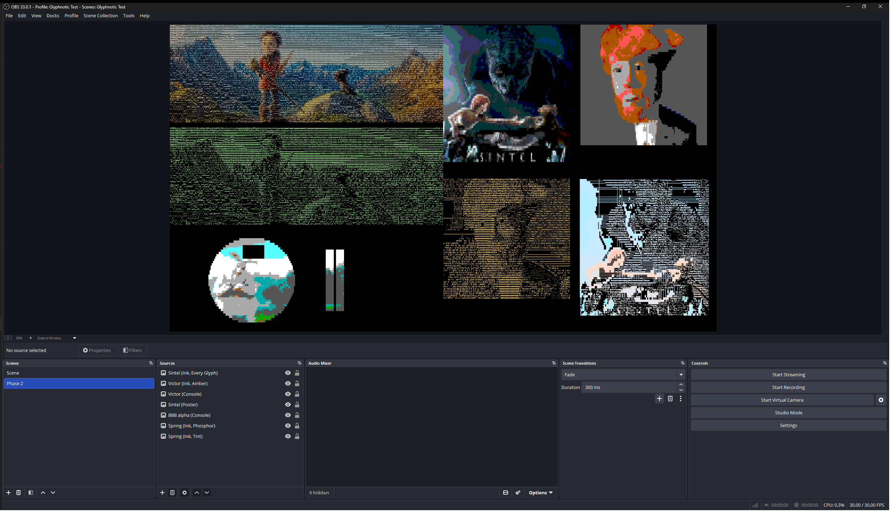
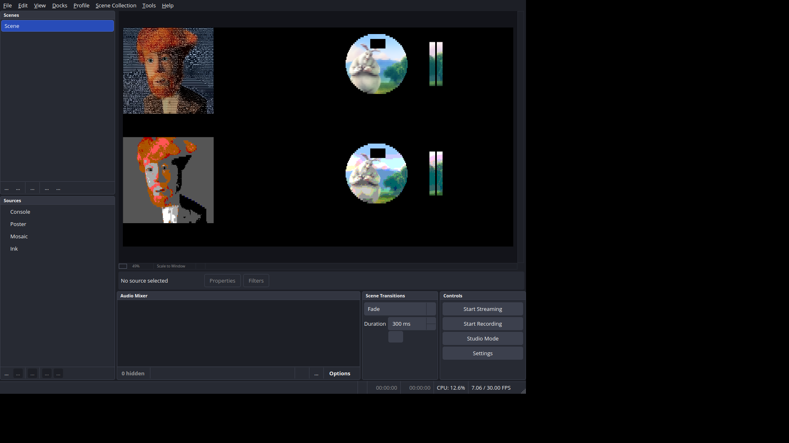

# Phase 2: Ink, Poster, Console

Date: 2026-11-11. Plugin version 0.1.0. Built against OBS Studio 33.0.1.

Review changes (2026-11-11, after the first review): a slider drag right
after a look was checked in OBS's window, found to be dropped, and fixed
(the properties window now refreshes once the changes stop); test
collection backups moved to `D:\Repos\Glyphnotic_backups\`; clang-format
and gersemi pinned in the repository's `.venv`; and a Linux check (OBS 33
under `xvfb-run` in an Ubuntu 26.04 container), which is now a standard
end-of-phase step.

## Acceptance

| Item | Result |
| --- | --- |
| All four filters with their settings; Auto and Manual levels; VGA and custom palettes; Capture palette | **Done.** "Glyphnotic Ink", "Mosaic", "Poster" and "Console" are registered, each with a Look list, the Characters and Grid groups and its own group. Auto levels ease as specified and snap when the grid resets; Manual uses the black and white points; Console draws with VGA, custom or captured palettes. |
| Reference match as in Phase 1, for each mode and character set | **Done.** 66 still cases over all four modes and all five character sets (442,116 cells): every case passes, 60 of them with 100% of cells matching and the rest ≥ 99.97%; the 6 mismatched cells all have cost gaps under 1e-8. Identical results on Direct3D 11 and OpenGL. |
| All looks from Looks are present and apply | **Done.** All 10 looks are in their filters' Look lists, apply from settings and from the properties window, and each look's picture matches the reference (`run_looks.py`: 577 checks, 0 failures, on both renderers). |

## What was built

- **Ink** (`score.effect` technique Ink, `cell-color.effect` technique Ink,
  and two new passes):
  - `levels.effect`: **Reduce** sums `(1, L, L²)` over the cells drawn
    opaque, 16×16 blocks per pass, down to one texel; **Levels** (1×1)
    turns that into `μ`, `σ` and Auto's target and eases it against the
    previous frame's levels (two 1×1 targets, ping-pong), or outputs
    Manual's `lo`/`hi`. Easing uses `1 − e^(−dt / adapt speed)` with `dt`
    from the filter's `video_tick`. The levels snap on the first frame and
    whenever the grid resets (character set, cell scale, alignment, a mode
    color setting or the source size changes).
  - `lightness.effect`: each sample's `L'`, which Ink's Score pass reads in
    place of the samples (so `pow` runs once per sample, not once per glyph).
  - Score: density against the cell's mean `L'` plus Shape times the
    glyph's fit; Color: the ink (Cell × Saturation, Green, Amber, White or a
    custom color's a, b) on black or the tint.
- **Poster**: Mosaic's scoring and colors; `draw.effect` snaps each encoded
  channel to the Levels, so the snap comes after Settle in Phase 3.
- **Console**: `score.effect` and `cell-color.effect` technique Console,
  reading the palette from a 16×1 float texture of OKLab colors.
  `capture.effect` averages the Sample output down to about 160×90 for
  **Capture palette**; the filter reads it back once and a worker thread
  runs k-means (`src/palette.cpp`), then writes the 16 colors into the
  settings, sets Palette and the Look to Custom and refreshes the
  properties window. The worker holds a weak reference, so a filter removed
  meanwhile is left alone; the filter joins the thread on destroy.
- **Looks** (`src/presets.cpp`): the table of the 10 looks; each sets every
  setting in Characters, Motion and the mode's own group (listed or
  default). `src/modes.cpp` applies them: one modified callback on every
  property applies a chosen look, turns the Look to Custom when a setting
  it controls changes, and shows or hides the conditional properties. It
  asks the window to refresh only when something changed, so dragging a
  slider isn't interrupted. Settings that arrive without the window (scene
  files, scripts) get the same rule in the filter's update: a newly named
  look fills in its settings; settings that no longer match an unchanged
  look turn it to Custom.
- **Settings** (`src/settings.hpp`, `src/modes.cpp`): new keys, saved in
  scene files and fixed from now on: `look`; Motion's `soften`, `hold`,
  `settle`, `boil`, `boil_spread`, `boil_linger` (set by the looks, no
  controls until Phase 3); Ink's `ink_color`, `ink_custom_color`,
  `ink_background`, `ink_lightness`, `saturation`, `gamma`, `shape`,
  `ink_levels`, `adapt_speed`, `black_point`, `white_point`; Poster's
  `poster_levels`; Console's `palette` and `palette_0` … `palette_15`
  (OBS colors). String values: looks `black`, `tint`, `phosphor`, `amber`,
  `every_glyph`, `static`, `fever`, `blocks`, `poster`, `console`,
  `custom`; ink colors `cell`, `green`, `amber`, `white`, `custom`;
  backgrounds `black`, `tint`; levels `auto`, `manual`; palettes `vga`,
  `custom`.
- **Unit tests**: `tests/unit/palette-test.cpp` (84 checks): color
  conversions, the VGA palette, k-means (finds 16 clusters, orders them by
  size, repeats exactly, copes with 3 colors or none) and the looks table.
- **Test tools**: the reference covers all four modes; `run_stills.py` runs
  66 cases; new `run_looks.py` and `run_levels.py`; the harness gained
  `--ui-set` (change settings the way the properties window does),
  `--ui-no-update`, `--press`, `--settings-out`, `--properties-out` and
  `--then-image`/`--dump2`. `tools/README.md` has the commands.

## How it was tested

Machine as in Phase 1: Windows 11 Pro 25H2, NVIDIA GeForce RTX 4070 Ti
(driver 32.0.16.2101), OBS 33.0.1, MSVC 14.51. Python 3.14.7, NumPy 2.5.4
in the repository's `.venv`.

### Reference match

`run_stills.py` ran 66 cases: Phase 1's 25 Mosaic cases unchanged, plus
18 Ink, 10 Poster and 13 Console cases. Together they cover every
character set in every new mode, all four cell scales, both alignments and
edge fills, Keep transparency on and off, the scene path, each ink color
(Cell, Green, Amber, White, Custom) and background, Auto and Manual levels
(including a white point below the black point), the Ink sliders at both
ends, Poster at Levels 2, 6, 7 and 16, and Console with VGA, a custom
palette and a captured palette (Capture palette pressed in the harness;
the case also checks that Palette and the Look became Custom).

Each case checks what Phase 1 checked (character set, geometry, glyph
match and gap, cell colors against the reference's colors for the plugin's
glyph, opacity, the output frame against the picture the dump describes),
plus Ink's `lo`/`hi` against the reference's within 1e-5, and Poster's
snapped colors in the frame. Flat-cell checks apply to Mosaic and Poster.

| Mode | Cases | Cells | Lowest match | Mismatched cells | Largest gap | Max color error (/255) | Bad frame pixels | Leaks |
| --- | --- | --- | --- | --- | --- | --- | --- | --- |
| Mosaic | 25 | 159,865 | 100% | 0 | – | 0.003 | 0 | 0 |
| Ink | 18 | 116,821 | 99.98% | 4 | 8.2e-9 | < 0.001 | 0 | 0 |
| Poster | 10 | 60,355 | 100% | 0 | – | 0.003 | 0 | 0 |
| Console | 13 | 105,075 | 99.97% | 2 | 4.0e-10 | < 0.001 | 0 | 0 |

The cases with any mismatch: `ink-victor-custom` (1 cell, gap 8.2e-9),
`ink-bbb-alpha-ascii-opaque` (1, 1.7e-10), `ink-patches-ascii-white` (1,
3.5e-18), `ink-sintel-ascii-manual-narrow` (1, 1.4e-17),
`console-victor-ascii` (2, 4.0e-10). Ink's levels matched the reference's
within 6e-7 in every Auto case. Direct3D 11 and OpenGL (OBS's OpenGL
renderer on Windows) gave identical tables. A run of all 66 takes about
4 minutes per renderer.

### Looks and properties

`run_looks.py` (577 checks, 0 failures, on Direct3D 11 and OpenGL), on
`victor.png`:

- A new filter of each kind starts on its first look (Black, Blocks,
  Poster, Console) with that look's settings.
- Each Look list is the filter's looks from the spec plus Custom, in
  order. The script holds its own copy of the spec's table, so it checks
  the plugin's table rather than reusing it.
- Every look, named in the settings at creation, sets every value it
  controls; its picture matches the reference (100% of cells for all 10).
- Every look, chosen the way the properties window chooses it (harness
  `--ui-set` with `--ui-no-update`, so the properties callbacks act
  alone, without the filter's update), sets the same values.
- Changing a setting a look controls (Gamma, Set, Levels, Palette) turns
  the Look to Custom; changing Cell scale doesn't.
- Mode settings appear only in their own filter; Custom characters, the
  fallback note, the custom ink, Adapt speed, Black/White point and the
  16 palette colors show only when they apply.

### Ink's levels over time

`run_levels.py` runs Ink on `victor.png` at 30 fps, switches the image,
runs 30 more frames and dumps again. Direct3D 11 and OpenGL gave the same
numbers:

| Case | Frames between dumps | `lo`, `hi` before | `lo`, `hi` after | Expected after | Result |
| --- | --- | --- | --- | --- | --- |
| Adapt speed 1.5 s, to a darkened victor | 33 | 0.0619, 0.7317 | 0.0658, 0.5888 | 0.0652–0.0659, 0.5825–0.6094 | pass |
| Adapt speed 0.2 s, same | 33 | 0.0619, 0.7317 | 0.0696, 0.4464 | 0.0696–0.0697, 0.4459–0.4492 | pass |
| Switch to `spring.png` (another size) | 33 | 0.0619, 0.7317 | 0.2042, 0.8481 | spring's target, snapped | pass |
| Manual, black 0.2, white 0.7 | 33 | 0.2000, 0.7000 | 0.2000, 0.7000 | 0.2, 0.7 | pass |

"Expected after" is the easing curve for the frames between the two
dumps, allowing up to 8 of them for the switch to reach the filter. The
second picture matched the reference scored with the dump's own levels in
every case (100%).

### OBS's other color paths

`run_color_paths.py` (Mosaic, Phase 1's cases) still passes all seven cases with the same figures as in Phase 1, after the refactoring of the filter core.

### Performance (rough)

The harness ran `patches.png` (1920×1080) at 60 fps for 600 frames with
OBS's source profiler on, on the RTX 4070 Ti:

| Filter | Set | Lagged frames | GPU time (avg / max) |
| --- | --- | --- | --- |
| Mosaic | Every glyph | 0 of 600 | 5.94 / 6.26 ms |
| Ink | ASCII | 0 of 600 | 2.99 / 4.55 ms |
| Ink | Every glyph | 0 of 600 | 4.42 / 8.47 ms |
| Poster | Lines | 0 of 600 | 2.51 / 4.00 ms |
| Console | Lines | 0 of 600 | 2.46 / 3.94 ms |
| Console | Every glyph | 0 of 600 | 6.33 / 6.64 ms |
| Ink ×3, one source each | ASCII | 0 of 600 | 1.27, 1.17, 1.32 ms avg |

These are rough: the single Ink/ASCII instance measured slower than each of
three (the GPU's clocks likely vary with load). Phase 5 has the real
measurement. Console with Every glyph is the heaviest, about 7% above
Mosaic, from its 24 palette reads per glyph.

### Unit tests and formatting

`font-test` (41 checks), `grid-test` (76) and `palette-test` (84) pass with
MSVC. clang-format 19.1.7 and gersemi 0.21.0 report no changes.

### In the OBS window

OBS 33.0.1 started from `bin\64bit` with `--collection "Glyphnotic Test"
--profile "Glyphnotic Test"`, the release build installed in
`C:\ProgramData\obs-studio\plugins\glyphnotic\`. A scene "Phase 2" was
added to the collection (with OBS closed, after a backup) with seven image
sources at half size: Spring with Ink Tint and Ink Phosphor, Sintel with
Poster and Ink Every Glyph, Victor with Console and Ink Amber, and the
alpha still with Console. Each filter was saved naming only its look.



- All seven draw. The alpha still's transparent cells are cut out under
  Console.
- The OBS log shows no Glyphnotic errors and "Number of memory leaks: 0"
  at exit.
- In the collection OBS saved on exit, each new filter kept its look, and
  Phase 1's two Mosaic filters, saved before looks existed (no `look`
  key), loaded as Custom with their settings unchanged.
- The Look list, the Custom switch, the conditional properties and
  Capture palette were checked through OBS's properties API in the harness
  (above). The slider drag below was checked in the window itself.

### A slider drag right after a look (review change)

At the first review the question was whether the first slider move after a
look, which turns the Look to Custom, drops the drag in OBS's window. It
was checked in the window with real mouse input: Windows UI Automation
opened the Filters window of a source on a look, and the mouse dragged the
Gamma slider from 0.85 toward 1.40 in 20 steps over a second (the scripts
are in the session scratchpad, not the repository).

| Build | Drag | Gamma after | Look after |
| --- | --- | --- | --- |
| Before the change, on Tint | first after the look | **0.88** (dropped after one step) | Custom |
| Before the change, same filter | second (Look already Custom) | 1.41 | Custom |
| After the change, on Amber | first after the look | 1.41 | Custom |
| After the change, same filter | Shape, second | 0.81 (as aimed) | Custom |

The drag was dropped because rebuilding the properties window mid-drag
deletes the slider being dragged. The properties callback now turns the
Look to Custom without refreshing. The window still has to show Custom, so
the filter refreshes it once the changes stop: OBS's Filters window
updates the filter on every step of a drag, each update pushes a pending
refresh 0.6 s further out, and the filter's tick sends OBS's
"update_properties" when it comes due. A first attempt that refreshed from
the update directly still dropped the drag, for that reason.

Also checked in the window with real clicks after the change: choosing
Amber in the Look list puts Gamma back to 0.85 at once, and choosing Tint
under Background turns the Look to Custom about half a second later. OBS's
log showed no Glyphnotic errors and 0 leaks. `run_looks.py` still passes
all 577 checks.

### Linux, in OBS (review change)

`tools/linux-check/obs-xvfb-check.sh` ran in a fresh `ubuntu:26.04`
Docker container (Docker Desktop, WSL 2): OBS 33.0.0 from OBS's PPA, the
plugin built with GCC as CI builds it (warnings as errors), the three unit
test programs passing, the plugin installed to `/usr` (the .deb's layout),
then OBS under `xvfb-run` for 40 s on a test collection with one image
source per filter, each on its first look, and stopped with SIGINT. From
OBS's log:

```
OBS 33.0.0 (linux)
Loading up OpenGL on adapter Mesa llvmpipe (LLVM 21.1.8, 256 bits)
[glyphnotic] plugin loaded successfully (version 0.1.0)
[glyphnotic] plugin unloaded
Number of memory leaks: 0
```

All four filters were created; there were no Glyphnotic errors or
warnings, no effect load errors and no failed draws. All four draw (X
screen below; llvmpipe renders on the CPU, so OBS ran at about 7 fps). The
other errors in the log are the container's missing D-Bus and DRI3, as in
Phase 0. This is the first time the plugin's GPU passes ran on Linux; the
reference comparison itself (the harness on Linux) still hasn't.



### Formatting environment (review change)

clang-format 19.1.7 and gersemi 0.21.0 are now pinned in
`tools/reference/requirements.txt` with NumPy and installed in the
repository's `.venv`, which ran the format checks above.

## Findings

These changed the design. All are now in the spec.

1. **Exact ties need exact arithmetic on both sides.** Two cases, both
   cells where many glyphs draw the same picture:
   - *Console:* when a glyph's text and background get the same palette
     slot, the cell is one color whatever the glyph, so all such glyphs tie
     in exact arithmetic. The GPU then picked among them by rounding: 7% of
     victor's cells differed from the reference (picture identical, cost
     gap 6e-17). The cost of that case is now computed from the cell's
     totals, so the tie is exact and the lowest index wins on both sides.
     A side with no counted samples also takes the other side's slot, as
     Mosaic's colors already did.
   - *Ink:* in a flat cell, glyphs with equal lit counts tie exactly. The
     GPU's sequential sums kept the tie; NumPy's matrix product didn't, and
     `patches.png` matched only 98.6%. `S_on` is now summed relative to the
     first counted sample's `L'`, as Mosaic's sums are, so a flat cell sums
     exact zeros everywhere.
2. **A shader that ignores its uv fails on OpenGL.** The 1×1 Levels pass
   didn't read its texture coordinate; the GLSL compiler dropped the
   attribute and libobs's OpenGL draw refused to run (`device_draw (GL)
   failed`), so every Ink case failed on OpenGL while Direct3D was fine. The
   pass now takes its texel from the uv. Every pass reads its uv now.
3. **Ink's levels need a definition for transparency and narrow ranges.**
   Auto levels use only cells drawn opaque (a keyed camera's transparent
   cells would otherwise pull `μ` to 0), and the spec now says exactly how
   a range under 0.05 widens and how Manual's points combine.

## Deviations from the spec, with reasons

- **Looks control a defined set of settings** (Characters except Custom
  characters, Motion, the mode's group), not Grid, Custom characters, the
  custom ink or the custom palette colors. The spec didn't say; those are
  layout or the user's own picks. Written into Filters and settings.
- **Looks set Motion's values now, without controls.** Phase 3 adds the
  controls and the passes; the keys and values are already saved, so a
  scene saved now keeps its look's motion settings.
- **A filter created with settings that name no look keeps them** (Look
  shows Custom if they differ from the first look), so scripts and the
  test tools can set any combination; settings that name a look get it.
- **Boil spread and Boil linger default to 20 and 2** (Static's values); the
  spec gave no defaults.
- **Capture palette downsamples the Sample output**, not the raw input: it's
  already in OKLab at the grid's area, and the spec's "about 160×90" holds.
- **A Lightness pass** at sample resolution feeds Ink's Score pass, and a
  **Capture** pass serves Capture palette; the spec allows splitting passes.
- **No Light jump yet**: Phase 3. Auto levels snap on the first frame and
  on a grid reset only.

## To try

Things worth a look in the OBS window; none blocks Phase 3.

- Put **Glyphnotic Ink** on a camera or game capture and step through the
  Look list: Black, Tint, Phosphor, Amber, Every Glyph, Static, Fever
  (Static and Fever look like Phosphor and Tint until Phase 3 adds Boil).
- Change Gamma or Shape: the Look switches to Custom. Pick a look again and
  the sliders jump to its values.
- Switch Ink's Levels between Auto and Manual, and move Black point and
  White point. With Auto, cover the camera and uncover it: the picture
  should adjust over about a second and a half.
- On **Glyphnotic Console**, press **Capture palette** on a colorful
  scene: Palette switches to Custom and the 16 colors fill in.
- **Glyphnotic Poster** at Levels 2 and 16.

## Open questions

- **Static and Fever** differ from Phosphor and Tint only in motion
  settings, so until Phase 3 they look the same as those.
- **Ink's look on flat areas**: flat regions all take the same glyph, which
  can read as a pattern of one character (e.g. `(=)` on victor's gray
  background). That's the cost function working as specified; Phase 4's
  tuning may want Shape or Gamma defaults that soften it.
- **Every Glyph on bright pictures** (Sintel, bottom right in the window
  capture) fills bright areas with near-solid blocks in the cell's
  saturated ink, which reads harsh next to the other looks. It matches the
  spec and the reference; Phase 4's tuning should look at Saturation and
  Ink lightness for this look.
- **Capture palette's GPU readback** stalls the pipeline for one frame
  when pressed. It's a one-off click, so it isn't worth a deferred readback
  now.

## Spec updates made

- Repository layout: `settings.hpp`, what `modes.cpp`, `palette.cpp` and
  `presets.cpp` hold, the new effects.
- Scoring: Ink's `level(g)` uses the glyph's own lit count, its `S_on` is
  summed relative to the first counted sample; Console's empty sides and
  one-slot cells.
- Levels: which cells count, the 0.05 widening, the easing formula, when
  they snap, Manual's `hi`.
- Render passes: Reduce and Levels, Lightness, Poster's snap in Draw,
  Capture.
- Filters and settings: what a look controls and how looks and settings
  stay consistent outside the window; conditional properties; Capture
  palette's details.
- Looks: Boil, Boil spread and Boil linger defaults.
- Phase 2 boxes ticked.
