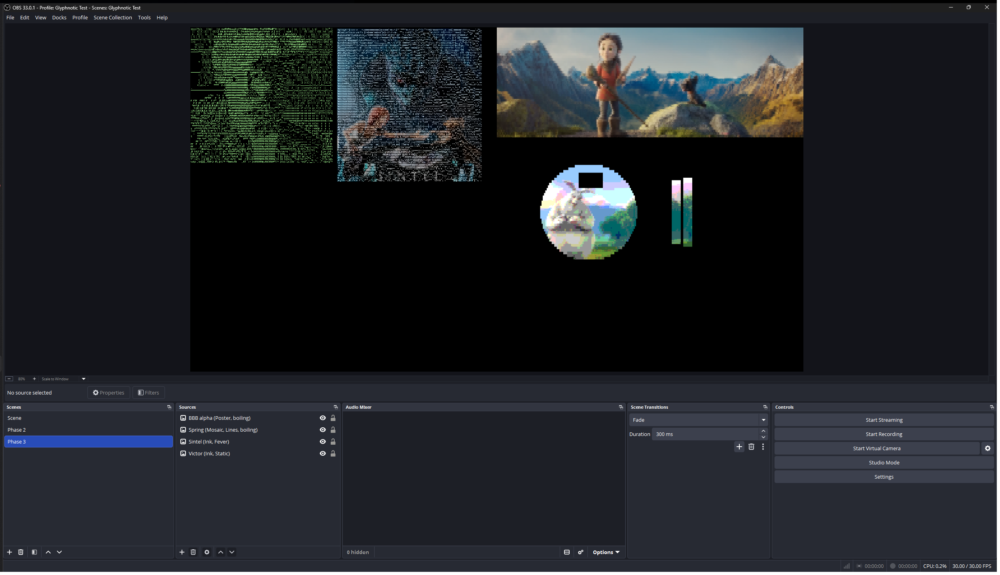
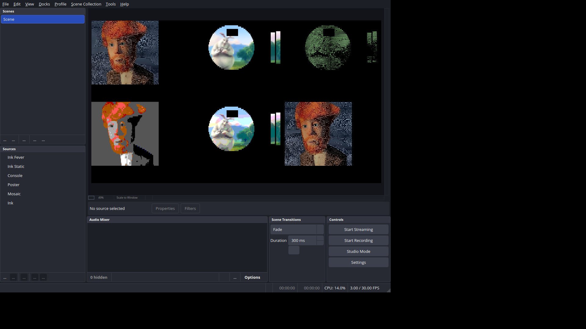

# Phase 3: motion

Date: 2026-11-11. Plugin version 0.1.0. Built against OBS Studio 33.0.1.

## Acceptance

| Item | Result |
| --- | --- |
| Soften, Hold, Settle, Boil, Boil spread, Boil linger, Light jump | **Done.** All six settings have controls in a new Motion group of every filter and act as specified; Light jump is detected every frame. Soften matches the reference (100% of cells in 14 new still cases); Hold keeps exactly the glyphs the reference's costs predict; Settle follows its formula to 3e-8; Boil's rate, linger and spread are as set; a light jump gives a fresh pick. |
| Flicker test (≤ 3% of cells per frame for non-boiling looks at their settings) | **Done.** victor.png with fresh Gaussian noise (σ = 2/255) on every frame, 600 frames, every look: with motion off 2.3–47% of cells change glyph per frame; at the looks' settings 0.00–0.11% for the eight non-boiling looks (Static 3.8%, Fever 11.4%, which boil by design). |
| Light jump: the first frame after each switch matches a fresh pick in 100% of cells | **Done.** victor and a same-size crop of sintel alternating every 15 frames, all 10 looks: 6 light jumps each, every one exactly at the switch, and the first frame after it matches a fresh pick (a new filter on that still) in 100% of cells, with no boil and the fresh colors. |
| Boil 0: consecutive frames identical. Boil > 0: swap rate within ±20%. A swapped cell returns after its linger, even at Hold 100 | **Done.** Boil 0: every look (Static and Fever with Boil 0) gives 20 identical recorded frames (glyphs and colors, bit for bit) and two identical output frames. Boil > 0: 10 cases at 30 and 60 fps, Boil 10–100, linger 1–12, Hold 10–100, rates within 1.4% of the setting; every one of ~800,000 swaps lasts exactly its linger and then shows the held glyph (or starts a new swap); held glyphs never change on a still, including at Hold 100. |

Direct3D 11 and OpenGL (OBS's OpenGL renderer on Windows) gave the same
results. The Linux check passed (run once Launchpad came back; see
"Linux check" below).

## What was built

- **Settings and properties** (`src/settings.hpp`, `src/modes.cpp`): a
  Motion group in every filter, between Grid and the mode's group: Soften
  (0–2 px, step 0.1), Hold (0–100), Settle (0–95%), Boil (0–100), Boil
  spread (0–100), Boil linger (1–12 frames). The keys (`soften`, `hold`,
  `settle`, `boil`, `boil_spread`, `boil_linger`) were already saved by
  Phase 2's looks; none changed. Changing any of them turns the Look to
  Custom, as for the other settings a look controls. Motion changes don't
  reset the grid's history.
- **`src/motion.hpp`** (no libobs dependency): Hold's `K_mode`, Boil's
  chance per frame (`1 − e^(−r·dt)`, `r = 4 × Boil/100` per second, `dt`
  from OBS's configured frame rate), Boil spread's share of the cost range,
  Soften's kernel.
- **Soften** (`soften.effect`, `sample.effect`): a separable Gaussian on
  the filter's input as OBS hands it over (8-bit sRGB-encoded,
  premultiplied). The row pass draws OBS's input into a float target at
  source size; the column pass happens as Sample reads that target
  (technique `DrawSoft`), so only one source-size float target is needed.
  Soften 0 skips it and runs Sample exactly as before.
- **Light jump** (`levels.effect`): Reduce now runs in every mode. Its first
  pass also counts the cells whose raw mean lightness changed by more than
  0.12 from the previous frame's Cell stats (now a ping-pong pair), and the
  Levels pass became 2×1: texel 1 holds the light jump and its share,
  texel 0 Ink's levels, which snap on a jump.
- **Hold and Boil** (`score.effect`, rewritten): one technique for all
  modes, with the mode's cost chosen by a uniform and each mode's arithmetic
  unchanged (the exact ties of Phases 1–2 still hold). Per cell it finds the
  best and worst cost and the held glyph's cost in one loop; Hold keeps the
  held glyph unless the best is cheaper by more than the threshold; a cell
  not swapping starts a swap with Boil's chance, picking uniformly
  (reservoir sampling) among the glyphs other than the held one within the
  spread, in a second loop that only starting cells run. Randomness is a PCG
  hash of cell, per-instance seed and frame counter. The output keeps
  Phase 1's layout (held, shown, boil frames left, best cost), in a
  ping-pong pair.
- **Settle** (`cell-color.effect`): each color texel blends with the same
  texel of the previous frame (a ping-pong pair), `c_new + (c_prev − c_new)
  × Settle`, except on a light jump or a fresh grid.
- **Filter core** (`src/glyph-filter.cpp`): the ping-pong pairs share one
  index; a frame whose passes fail part way starts the history over; the
  per-instance seed comes from the time and the instance's address.
- **Debug tools**: a **Record grid** button that records every following
  frame's held and shown glyphs, boil state, light jump and (optionally)
  colors to a binary file; the grid dump is version 3 (motion settings,
  Hold's threshold, seed, light jump, `boil` per cell).
- **Unit tests**: `tests/unit/motion-test.cpp` (103 checks): Hold's
  threshold, Boil's chance (the same rate at 24, 30, 60 and 144 fps), the
  spread, Soften's kernel.
- **Test tools**: the reference implements Soften; `compare.py` takes
  Soften from the dump, widens its flat-cell check by the blur's radius,
  and compares held glyphs when Boil is on; the harness has a frame-sequence
  source (stills in turn, fresh Gaussian noise on every frame), `--record`
  and `--frame-pair`; new `run_motion.py` (7 suites, 456 checks).
  `tools/README.md` has the commands and formats.
- **Linux check script**: Ink Static and Fever added to the test collection,
  so the boil hashing runs under Mesa's GLSL compiler.

## How it was tested

Machine as in Phases 1–2: Windows 11 Pro 25H2, NVIDIA GeForce RTX 4070 Ti
(driver 32.0.16.2101), OBS 33.0.1, MSVC 14.51, Python 3.14.7 and NumPy
2.5.4 in the repository's `.venv`. Every suite ran on Direct3D 11 and on
OBS's OpenGL renderer.

### Motion over time (`run_motion.py`, 456 checks, 0 failures on each renderer)

**Source.** The harness's frame-sequence source hands a filter exactly the
same picture as OBS's image source (identical grids and colors for Mosaic,
Ink and Console, on victor and on the alpha still).

**Flicker.** victor.png plus fresh Gaussian noise of σ = 2/255 on every
color channel of every frame (rounded to 8 bits), 600 frames at 30 fps.
"Motion off" is the look's settings with Soften, Hold, Settle and Boil 0.
Share of cells whose shown glyph changes from one frame to the next (mean
over the 599 frame pairs, and the worst pair):

| Filter | Look | Motion off | Look's settings | Result |
| --- | --- | --- | --- | --- |
| Ink | Black | 31.89% (max 33.30%) | 0.00% (max 0.00%) | pass |
| Ink | Tint | 31.89% (max 33.30%) | 0.00% (max 0.00%) | pass |
| Ink | Phosphor | 31.89% (max 33.30%) | 0.00% (max 0.00%) | pass |
| Ink | Amber | 31.89% (max 33.30%) | 0.00% (max 0.00%) | pass |
| Ink | Every Glyph | 6.35% (max 7.22%) | 0.00% (max 0.03%) | pass |
| Ink | Static | 31.89% (max 33.30%) | 3.84% (max 4.76%) | boils (held glyphs: 0.00%) |
| Ink | Fever | 31.89% (max 33.30%) | 11.40% (max 12.51%) | boils (held glyphs: 0.11%) |
| Mosaic | Blocks | 27.97% (max 29.17%) | 0.08% (max 0.19%) | pass |
| Poster | Poster | 47.08% (max 48.84%) | 0.11% (max 0.29%) | pass |
| Console | Console | 2.31% (max 2.75%) | 0.07% (max 0.17%) | pass |

Direct3D 11 figures; OpenGL's are identical except for the boiling looks
(Static 3.83%, Fever 11.39%: each run has its own Boil seed). Why Ink's
Every Glyph flickers less than ASCII with motion off (6% against 32%) wasn't
investigated; it doesn't affect the acceptance.

**Boil 0 on a still.** Every look (Static and Fever with Boil 0) on
victor.png: 20 consecutive recorded frames have bit-identical held and
shown glyphs and colors, and two consecutive output frames from OBS are
byte-identical.

**Boil on a still** (victor.png, 10 s each). The rate is measured as a
Poisson rate, `−ln(1 − p) × fps`, from the share `p` of free cells (not
already swapping) that start a swap per frame:

| Case | fps | Boil | Linger | Hold | Set (/s) | Direct3D (/s) | OpenGL (/s) | Swaps showing another glyph |
| --- | --- | --- | --- | --- | --- | --- | --- | --- |
| Ink Static | 30 | 15 | 2 | 25 | 0.600 | 0.601 | 0.599 | 100% |
| Ink Static | 60 | 15 | 2 | 25 | 0.600 | 0.600 | 0.606 | 100% |
| Ink Fever | 30 | 45 | 1 | 10 | 1.800 | 1.803 | 1.794 | 100% |
| Ink Fever | 60 | 45 | 1 | 10 | 1.800 | 1.805 | 1.791 | 100% |
| Ink, spread 50 | 30 | 100 | 1 | 100 | 4.000 | 3.988 | 4.002 | 100% |
| Mosaic, spread 100 | 30 | 30 | 12 | 100 | 1.200 | 1.201 | 1.203 | 6% |
| Mosaic, spread 100 | 60 | 30 | 12 | 100 | 1.200 | 1.205 | 1.201 | 6% |
| Poster, spread 20 | 30 | 10 | 2 | 10 | 0.400 | 0.406 | 0.402 | 17% |
| Console, spread 20 | 60 | 60 | 4 | 10 | 2.400 | 2.403 | 2.390 | 18% |
| Ink Every Glyph, spread 0 | 30 | 25 | 3 | 25 | 1.000 | 0.997 | 0.995 | 0% |

Largest error 1.4%. In every case, each of the 23,000–218,000 swaps checked
showed one glyph for exactly its linger, counting down, and then the held
glyph or a new swap; a cell not swapping always showed its held glyph; the
held glyphs never changed (Hold 10 to 100); every boiled glyph's cost was
within the spread of the reference's costs; and a swap showed the held
glyph only when no other glyph was clearly within the spread. That last
case is common in the Mosaic-family modes (see Open questions).

**Light jump.** victor.png and a 894×853 crop of sintel.png (69% of cells
change raw mean lightness by more than 0.12) alternating every 15 frames,
90 frames recorded, every look at its own settings (so Static and Fever
boil and Fever settles). Each look had 6 light jumps, exactly 15 frames
apart, alternating between the stills; at each, the held and shown glyphs
equal a fresh pick (a new filter on that still) in 100% of cells, no cell
boils, and the colors equal the fresh colors exactly (Settle restarted, Ink's
levels snapped). Every other frame's held glyphs also equal one still's
fresh pick. A control switch that isn't a light jump (victor to 0.8×
victor, 4.6% of cells beyond 0.12) was not flagged, and 90% of Ink Black's
cells then differed from a fresh pick (Hold, and the levels still easing).

**Hold** (no light jump: victor and 0.8× victor alternating every 20
frames). At each switch the script predicts each cell from the reference's
costs on the new still: keep the old glyph if its cost is within the
threshold of the best, else take the best.

| Case | Threshold | Switches | Cells kept | Cells within 1e-6 of the threshold | Wrong |
| --- | --- | --- | --- | --- | --- |
| Mosaic, Hold 100 | 2.5e-5 | 3 | 170 | 0 | 0 |
| Mosaic, Hold 30 | 7.5e-6 | 3 | 170 | 0 | 0 |
| Mosaic, Hold 0 | 0 | 3 | 0 | 0 | 0 |
| Poster, Hold 50 | 7.5e-5 | 3 | 890 | 0 | 0 |
| Console, Hold 100 | 0.0015 | 3 | 2,699 | 0 | 0 |
| Ink (Manual levels), Hold 100 | 0.003 | 3 | 4,039 | 10 | 0 |
| Ink (Manual levels), Hold 25 | 0.00075 | 3 | 385 | 2 | 0 |

"Cells kept" counts cells that kept a glyph that wasn't the new best. The
glyphs then stayed unchanged until the next switch. (Ink runs with Manual
levels here so that the costs on the first frame don't depend on easing.)

**Settle.** Ink Tint (its colors don't depend on the glyph) switching
victor and 0.8× victor every 10 frames, 40 frames: every frame's colors are
`c_new + (c_prev − c_new) × Settle` within 3e-8, at 50% and 95%.

### Reference match, looks, levels and color paths

`run_stills.py` now runs 80 cases: Phase 1–2's 66 with motion off (Soften,
Hold, Settle and Boil 0, set explicitly: a filter created without a look
takes the first look's motion values as defaults), and 14 new Soften cases
(0.1, 0.6, 1.0, 1.5 and 2.0 px, all four modes, cell scales 1–4,
top-left alignment, the alpha still and the scene path), compared with the
reference's blur.

| Group | Cases | Cells | Lowest match | Mismatched cells | Largest gap | Max color error (/255) | Bad frame pixels | Leaks |
| --- | --- | --- | --- | --- | --- | --- | --- | --- |
| Mosaic | 25 | 159,865 | 100% | 0 | – | 0.003 | 0 | 0 |
| Ink | 18 | 116,821 | 99.98% | 4 | 8.2e-9 | < 0.001 | 0 | 0 |
| Poster | 10 | 60,355 | 100% | 0 | – | 0.003 | 0 | 0 |
| Console | 13 | 105,075 | 99.97% | 2 | 4.0e-10 | < 0.001 | 0 | 0 |
| Soften | 14 | 85,607 | 99.99% | 1 | 1.8e-11 | 0.003 | 0 | 0 |

Direct3D 11 figures. OpenGL's are the same, except that its Soften cases
match in 100% of cells. Phase 1–2's rows are unchanged from Phase 2.

One check needed a tolerance: on the alpha still, some cells straddle a
straight alpha edge through their middle, so their mean alpha is exactly
0.5 (drawn opaque); under a symmetric blur the reference's float64 got
0.5 − 5.6e-17 and called 17 of them transparent, while the GPU got 0.5.
`compare.py` now accepts either opacity for a cell within 1e-6 of the
threshold and reports how many there are (5–19 per alpha case). Only that
one Soften case changed outcome; in the others the plugin and the
reference already agreed on those cells.

`run_looks.py`: 601 checks, 0 failures on each renderer (Phase 2's 577,
plus the Motion group's six properties shown in every filter). Every look's
picture, with its Soften of 0.6 px, matches the reference in 100% of cells;
for Static and Fever the held glyphs are compared, since boiling cells show
other glyphs.

`run_levels.py`: all 5 cases pass on each renderer. The easing cases now
switch to 0.8× victor (Phase 2 used 0.5×, which is now nearly a light jump;
see Findings), and a new case switches to 0.3× victor, a light jump: the
levels snap to its target at once.

`run_color_paths.py`: all 7 cases pass with Phase 1's figures.

### Performance (rough)

The harness ran `patches.png` (1920×1080) at 60 fps for 600 frames with
OBS's source profiler on, each look as set (Soften 0.6 px in all):

| Filter | Look | Lagged frames | GPU time (avg / max) | Phase 2 (no Soften) |
| --- | --- | --- | --- | --- |
| Ink | Black | 0 of 600 | 3.66 / 5.28 ms | 2.99 ms (ASCII) |
| Ink | Fever | 0 of 600 | 3.21 / 6.60 ms | – |
| Ink | Every Glyph | 0 of 600 | 5.06 / 6.30 ms | 4.42 ms |
| Mosaic | Blocks | 0 of 600 | 1.97 / 5.06 ms | – |
| Poster | Poster | 0 of 600 | 2.96 / 5.06 ms | 2.51 ms |
| Console | Console | 0 of 600 | 2.46 / 7.71 ms | 2.46 ms |

As in Phase 2 these vary with the GPU's clocks (Fever measured faster than
Black); Phase 5 has the real measurement.

### Unit tests and formatting

`font-test` (41 checks), `grid-test` (76), `palette-test` (84) and the new
`motion-test` (103) pass with MSVC. clang-format 19.1.7 and gersemi 0.21.0
report no changes.

### In the OBS window

OBS 33.0.1 from `bin\64bit` with `--collection "Glyphnotic Test" --profile
"Glyphnotic Test"`, the release build installed in
`C:\ProgramData\obs-studio\plugins\glyphnotic\`. With OBS closed and after a
backup (`D:\Repos\Glyphnotic_backups\2026-11-11 before Phase 3 tests -
Glyphnotic_Test.json`), a scene "Phase 3" was added: victor with Ink
Static, sintel with Ink Fever, spring with Mosaic (Lines, Boil 40, spread
100, linger 6, Settle 50) and the alpha still with Poster.



- All four draw at 30/30 fps; Static and Fever boil visibly.
- The log shows no Glyphnotic errors and "Number of memory leaks: 0" at
  exit.
- OBS saved each new filter's look and its non-default motion values.
  Filters saved in Phases 1–2 without motion values now take the first
  look's motion defaults (Soften 0.6 and its Hold), so they look slightly
  softer than before.

### Linux check

**Passed**, after a delay. The check's first step installs OBS 33 from
OBS's PPA on Launchpad, and from about 09:00 on 2026-11-11 Launchpad was
unreachable (TLS handshake failures from both Docker and Windows; Ubuntu
26.04's own archive has only OBS 32.1.0). The commit's first CI runs failed
on the Ubuntu job for the same outage; a later rerun of the same commit
(65100c1) passed every job. Once Launchpad answered again,
`tools/linux-check/obs-xvfb-check.sh` ran in a fresh `ubuntu:26.04`
container: OBS 33.0.0 from the PPA, the plugin built with GCC as CI builds
it (warnings as errors), all four unit test programs passing (motion-test
included), then OBS under `xvfb-run` on a test collection with six image
sources: Ink, Mosaic, Poster and Console on their first looks, plus Ink's
Static and Fever looks, so the boil hashing and Settle ran under Mesa's GLSL
compiler. From the check's result:

```
OBS 33.0.0 (linux), plugin from /usr
Loading up OpenGL on adapter Mesa llvmpipe (LLVM 21.1.8, 256 bits)
pass: plugin loaded (1)
pass: filter glyphnotic_ink created (3)
pass: filter glyphnotic_mosaic created (1)
pass: filter glyphnotic_poster created (1)
pass: filter glyphnotic_console created (1)
pass: no Glyphnotic errors or warnings (0)
pass: no effect load errors (0)
pass: no failed draws (0)
pass: clean shutdown (1)
pass: no leaks (1)
```

All six sources draw (X screen below: top row Ink, Mosaic, Console; bottom
row Poster, Ink Static, Ink Fever). llvmpipe renders on the CPU, so OBS ran
at about 3 fps with six filters and Soften (Phase 2: about 7 fps with four).
The only other errors in OBS's log are the container's: no D-Bus, and the
AJA, DeckLink and NVENC modules finding no hardware. As before, the reference comparison itself hasn't run on
Linux; OBS's OpenGL renderer on Windows ran every suite above.



## Findings

1. **Cost scales differ by orders of magnitude between modes** (median
   cost range on victor: Ink 0.3, Console 0.014, Poster 9e-6, Mosaic
   3e-6), and noise sensitivity differs again within a scoring (Poster's
   Lines flicker 47% under noise with motion off, Mosaic's Blocks 28%).
   One `K_mode` for all modes would lock one mode and do nothing in
   another, so Phase 3 set provisional values per mode from the flicker
   test (below). A first try at 0.004 for every mode locked Mosaic and
   Poster completely at Hold 1.
2. **Direct3D refuses a draw when any referenced uniform is unset**
   ("Not all shader parameters were set"), even on a path that doesn't use
   it: Sample's plain technique references the blur's uniforms through a
   shared helper. OpenGL ran fine. Every uniform is now set on every path.
3. **Integer hashing works in libobs effects** on both renderers (`uint`,
   `u` literals, shifts, xor); GLSL 3.30 needs explicit `uint()` conversions.
4. **A light jump needs a big change.** Halving victor's encoded values
   changes only 46% of cells by more than 0.12, so it isn't a jump;
   `run_levels.py`'s jump case uses 0.3× (88%).
5. **A mean alpha can sit exactly on the 0.5 threshold** (a straight alpha
   edge through a cell's middle, blurred symmetrically), where float
   rounding decides. The plugin follows the spec (≥ 0.5 is opaque) whenever
   its float32 sum lands on 0.5; the test accepts either side within 1e-6.

## Deviations from the spec, with reasons

All are now written into the spec.

- **`K_mode` has provisional values now** (spec: set in Phase 4): Hold
  can't be built or tested without them. Rule: 10× the threshold at which
  fresh noise (σ 2/255) on victor, with the mode's first look, changes
  fewer than 0.1% of cells per frame, so Hold 10 holds against sensor noise
  and Hold 100 is almost locked. Ink 0.003, Mosaic 0.000025, Poster 0.00015,
  Console 0.0015. Phase 4 tunes them.
- **A swap never picks the held glyph when another glyph is within the
  spread** (spec: uniformly among glyphs within the spread). A "swap" to the
  glyph already shown is invisible, so at low spread most swaps would do
  nothing; with no other candidate the swap shows the held glyph.
- **Boil's rate applies to a cell that isn't already swapping**, as
  `p = 1 − e^(−r·dt)` per frame with `dt` from OBS's configured frame rate
  (spec: "chance that a cell starts a swap in a given second ... on
  average"). At 100 with linger 12 a cell can't swap 4 times a second, so
  the rate has to count free time; the measured rate uses the same
  definition.
- **No swap starts on a light jump or on a grid's first frame**, so those
  frames are exactly a fresh pick, as the acceptance requires.
- **Soften blurs the premultiplied, sRGB-encoded input**, not linear light:
  that's what OBS hands the filter, it keeps transparent pixels from
  bleeding, and Sample's decoding stays as it was. The column pass is
  folded into Sample, so Soften needs one source-size float target, not two.
- **Reduce and Levels run in every mode**, since the Light jump needs them;
  Levels is 2×1. The Light jump counts all cells, transparent ones too.
- **Settle is written `c_new + (c_prev − c_new) × Settle`**, the same as
  `mix(c_new, c_prev, Settle)` but exact when nothing changes, so a still
  with Settle on gives identical frames.

## To try

- Put **Glyphnotic Ink** on a camera and compare the Look list's Black with
  Custom at Hold 0 and Soften 0: the first should hold still, the second
  crawl with sensor noise.
- **Static** and **Fever** now boil. Try Boil linger 1 against 8 on Fever
  (flicker against crawl), and Boil spread 0 against 100 (readable against
  static).
- Move **Hold** from 0 to 100 while moving in front of the camera: at 100
  the picture should lag behind small movements but follow big ones.
- **Settle** at 90% on a colorful scene: colors should trail.
- Turn a light off and on: the picture should snap at once (Light jump)
  rather than fade.

## Open questions

- **Hold's feel for real motion.** `K_mode` is calibrated on noise. At the
  looks' Hold (10 and 25), noise is fully suppressed (0.00–0.11%), while
  on victor's 0.8× switch Ink at Hold 25 kept about 2% of cells on old
  glyphs and at Hold 100 about 23%; whether Hold
  100 is "almost locked" for real motion, and whether the Ink looks at 25
  are too stiff, needs a camera: Phase 4.
- **Boil is mostly invisible in Mosaic, Poster and Console.** Their cost
  ranges are dominated by a few very bad glyphs, so even at spread 100 most
  cells have no other glyph within the spread: only 6% (Mosaic, spread 100),
  17% (Poster, 20) and 18% (Console, 20) of swaps show a different glyph,
  against 100% in Ink. If those modes should boil visibly, Phase 4 could
  define spread on the cost of the next-best glyphs instead of the full
  range.
- **Soften's memory**: one RGBA32F target at source size per instance with
  Soften on (33 MB at 1920×1080). Half floats would halve it, at some cost to
  the reference match; Phase 5 measures.
- **Starting a swap costs a second pass over the glyphs** in that cell,
  and on the GPU the cells around it wait for it. The rough timing above
  shows no cost for Fever over Black at 1080p, but Phase 5 should measure
  it properly, with Every Glyph and boiling together.

## Spec updates made

- Repository layout: `motion.hpp`, `soften.effect`.
- Motion: the provisional `K_mode` values and their rule; Hold's exact rule;
  Settle's formula; Boil's rate (free cells, `1 − e^(−r·dt)`, OBS's frame
  rate), spread (other glyphs than the held one), linger; Soften's kernel
  and what it blurs; no swap on a light jump or a fresh grid; the seed.
- Render passes: Soften's row pass and Sample's column pass; Cell stats,
  Levels, Score and Color as ping-pong pairs; Reduce and the 2×1 Levels in
  every mode with the Light jump count; what resets the history.
- Reference implementation: covers Soften; Record grid and `run_motion.py`.
- Phase 3 boxes ticked.
