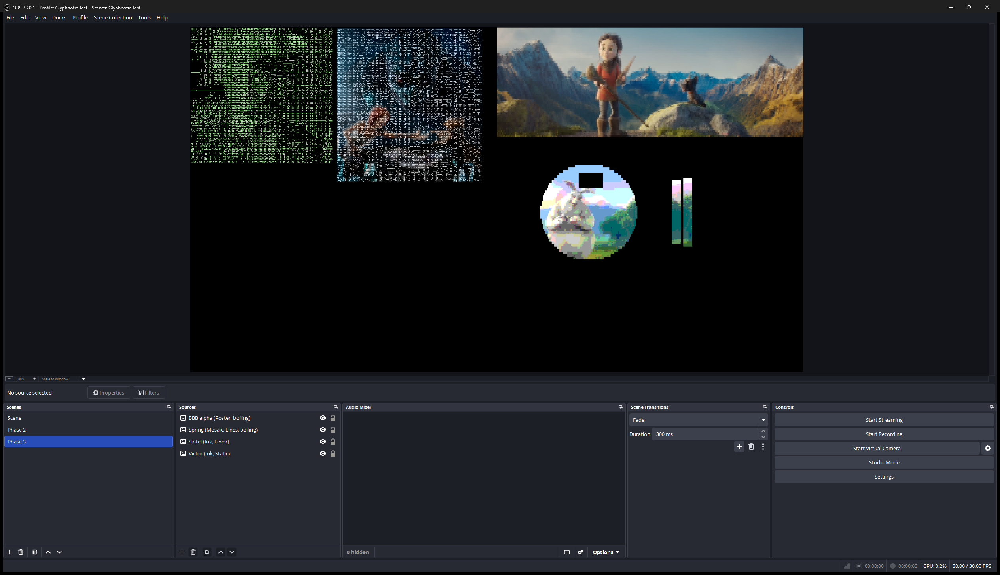
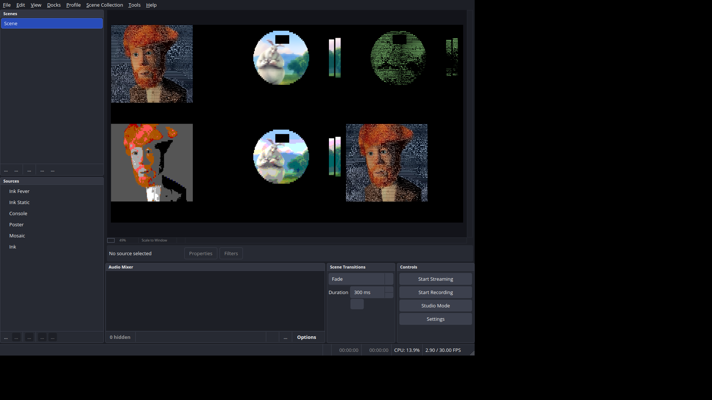

# Phase 4: tuning

Date: 2026-11-11. Plugin version 0.1.0. Built against OBS Studio 33.0.1.

## Acceptance

| Item | Result |
| --- | --- |
| `K_mode` set for each mode, and every slider range trimmed to the span that looks deliberate | **Done.** `K_mode` kept at Phase 3's values (Ink 0.003, Mosaic 0.000025, Poster 0.00015, Console 0.0015), now checked on motion as well as noise: on a still panning 1 px per frame, Hold 100 changes 5–14% as many cells per frame as Hold 0 in every mode, and 10–24% on a 4 px pan. Five ranges trimmed: Gamma 0.5–1.5 → 0.7–1.6, Shape 0–1 → 0–0.6, Black point 0–1 → 0–0.6, White point 0–1 → 0.2–1, Poster Levels 2–16 → 2–12. The rest measured and kept. |
| Final look defaults; `docs/LOOKS.md` with a still of each look on at least three test stills | **Done.** Blocks, Poster and Console go from Hold 10 to Hold 25 (at σ 4/255 noise, Hold 10 let Poster change 1.1% of cells per frame; Hold 25 keeps every look at or under 0.14%). Every other look setting stays. `docs/LOOKS.md` shows all 10 looks on victor, spring and sintel (30 crops drawn by the plugin, in `docs/looks/`). |
| Ranges, defaults and `K_mode` values written back into this spec | **Done.** Motion (`K_mode` and how it was checked), Filters and settings (the trimmed ranges, Adapt speed's range written out), Ink's Manual levels, Looks (Hold 25), Repository layout (`docs/looks/`). |

Every Phase 1–3 suite still passes on Direct3D 11 and OpenGL with the new
looks and ranges (below), and the Linux check passed.

## What was built

- **Ranges** (`src/settings.hpp`, `src/modes.cpp`): the trimmed ranges as
  named constants; they bound the properties window only. A value from a
  scene file or a script is used as before (the filter still clamps only
  the motion settings and Poster's Levels, to 2–16), so nothing saved
  changes how it draws.
- **Looks** (`src/presets.cpp`): Blocks, Poster and Console no longer set
  Hold 10; they take the default, 25, like Ink's looks. Look ids, setting
  keys and values are unchanged.
- **`src/motion.hpp`**: `K_mode`'s comment now says how the values were set
  and checked; the values are Phase 3's.
- **`tools/reference/run_tuning.py`** (new) with `tuning.py`: the
  measurements below, as five suites (`hold`, `noise`, `boil`, `ranges`,
  `looks`); `looks` draws the stills for `docs/LOOKS.md` with the plugin.
- **Harness**: `--properties-out` now writes each slider's `min`, `max` and
  `step`, and `run_looks.py` checks every slider's range against the spec.
- **`docs/LOOKS.md`** and `docs/looks/` (30 PNG crops, 578 KB).

## How the values were chosen

Machine as in Phases 1–3: Windows 11 Pro 25H2, NVIDIA GeForce RTX 4070 Ti,
OBS 33.0.1, Python 3.14.7, NumPy 2.5.4. The static settings were swept with
the reference (which matches the plugin in 100% of cells on a fresh pick),
on victor, spring and sintel with each mode's first look; Hold and the
looks under noise ran in the plugin through the harness. Contact sheets of
each sweep were looked at as well as measured; the rules below are what the
measurements could defend.

### Hold and `K_mode`

`run_tuning.py --only hold`: each mode's first look with Hold varied, on
victor (cropped to 760×853) with fresh Gaussian noise of σ 2/255 every
frame: as a still, panning 1 px per frame (a slow sway: 1/8 of a cell's
width per frame) and 4 px per frame (a quick move), 90 frames at 30 fps.
"Changes" is the share of cells whose shown glyph changes per frame (the
frame after the pan's wrap-around left out).

| Filter | Hold | Threshold | Still | Pan 1 px | Pan 4 px |
| --- | --- | --- | --- | --- | --- |
| Ink | 0 | 0 | 23.69% | 44.29% | 66.43% |
| Ink | 10 | 0.0003 | 0.11% | 18.54% | 39.82% |
| Ink | 25 | 0.00075 | 0.00% | 13.13% | 31.84% |
| Ink | 50 | 0.0015 | 0.00% | 8.97% | 24.02% |
| Ink | 100 | 0.003 | 0.00% | 5.27% | 15.69% |
| Mosaic | 0 | 0 | 4.20% | 6.86% | 8.87% |
| Mosaic | 10 | 2.5e-6 | 0.10% | 1.73% | 3.22% |
| Mosaic | 25 | 6.25e-6 | 0.02% | 1.09% | 2.10% |
| Mosaic | 50 | 1.25e-5 | 0.00% | 0.70% | 1.36% |
| Mosaic | 100 | 2.5e-5 | 0.00% | 0.37% | 0.85% |
| Poster | 0 | 0 | 32.69% | 47.05% | 65.42% |
| Poster | 10 | 1.5e-5 | 0.14% | 12.14% | 25.71% |
| Poster | 25 | 3.75e-5 | 0.01% | 8.64% | 19.56% |
| Poster | 50 | 7.5e-5 | 0.00% | 6.03% | 14.13% |
| Poster | 100 | 0.00015 | 0.00% | 3.57% | 8.72% |
| Console | 0 | 0 | 1.96% | 8.10% | 18.09% |
| Console | 10 | 0.00015 | 0.08% | 4.29% | 10.01% |
| Console | 25 | 0.000375 | 0.01% | 2.87% | 7.28% |
| Console | 50 | 0.00075 | 0.00% | 1.93% | 5.22% |
| Console | 100 | 0.0015 | 0.00% | 1.13% | 2.98% |

(Hold 75 was measured too; it falls between 50 and 100 in every column.)

At Hold 100, changes on the 1 px pan are 12% of Hold 0's for Ink, 5% for
Mosaic, 8% for Poster and 14% for Console; on the 4 px pan 24%, 10%, 13%
and 16%. So in every mode Hold 100 is almost locked on a slow sway and
still follows a quick move, and every step of the slider calms the grid
further: the whole 0–100 range is useful, and the modes agree within a
factor of about 2.5. Matching them more closely would mean lowering
Mosaic's `K_mode`, and then Hold 10 would no longer hold against noise in
Mosaic (it's at 0.10% now, the Phase 3 rule's limit). The noise rule is
what makes the looks work on a camera, so `K_mode` stays.

The suite also reports a staleness figure (the held glyph's cost above the
best, as a share of the cell's cost range, on the clean frame). It turned
out not to compare across modes: Ink's cost ranges are dominated by the
extreme glyphs (staleness under 0.002 at every Hold), and in Poster noise
alone puts Hold 0 at 0.14. It's in `build_tuning/hold.json` but wasn't used.

### The looks' Hold

`run_tuning.py --only noise`: every non-boiling look at Hold 10 and 25, on
victor with fresh noise of σ 2/255 (Phase 3's test) and 4/255 (a noisier
camera), 150 frames. Cells changing glyph per frame:

| Look | Was | Hold 10, σ 2 | Hold 10, σ 4 | Hold 25, σ 2 | Hold 25, σ 4 |
| --- | --- | --- | --- | --- | --- |
| Ink Black, Tint, Phosphor, Amber | 25 | 0.14% | 5.42% | 0.00% | 0.04% |
| Ink Every Glyph | 25 | 0.16% | 2.33% | 0.00% | 0.14% |
| Mosaic Blocks | 10 | 0.08% | 0.37% | 0.01% | 0.11% |
| Poster | 10 | 0.12% | 1.11% | 0.01% | 0.14% |
| Console | 10 | 0.08% | 0.40% | 0.01% | 0.11% |

Hold 25 keeps every look at or under 0.14% even at σ 4, where Hold 10 lets
Poster twinkle at 1.1%. The cost on the pans above is small (Poster 12.1%
→ 8.6% of cells per frame on the 1 px pan, Console 4.3% → 2.9%, Mosaic
1.7% → 1.1%), so Blocks, Poster and Console now use 25, like Ink's looks.
Phase 3's open question, whether Ink's 25 is too stiff, gets the same
answer: Ink at Hold 10 changes 5.4% of cells per frame at σ 4, so 25 stays.
Fever keeps Hold 10: it boils by design.

### Static settings (`run_tuning.py --only ranges`)

The rule for an end of a range: the end is where the picture on the test
stills is still a picture. Stills: victor / spring / sintel, each mode's
first look.

**Ink Gamma**: cells drawn as space, and with the densest glyphs (≥ 85% of
the set's most lit glyph):

| Gamma | Space | Densest |
| --- | --- | --- |
| 0.5 | 0.0% / 0.1% / 0.0% | 21.5% / 32.2% / 19.0% |
| 0.6 | 0.0% / 0.3% / 0.0% | 18.6% / 27.6% / 16.1% |
| 0.7 | 0.0% / 0.3% / 0.0% | 16.9% / 22.8% / 14.2% |
| 0.85 (default) | 0.0% / 0.5% / 0.1% | 14.7% / 18.2% / 12.5% |
| 1.0 | 0.0% / 1.3% / 0.6% | 12.9% / 14.2% / 11.1% |
| 1.3 | 3.1% / 4.3% / 4.0% | 10.6% / 8.2% / 9.1% |
| 1.5 | 4.6% / 8.5% / 9.9% | 9.7% / 5.0% / 8.4% |
| 1.6 | 5.4% / 12.1% / 14.1% | 9.4% / 4.0% / 8.2% |
| 1.7 | 7.1% / 15.7% / 18.3% | 9.0% / 3.1% / 7.9% |

Rule: at most a quarter of any still's cells at space or the densest
glyphs together. 0.6 breaks it on spring (27.9%), 1.7 on sintel (26.2%):
**0.7–1.6**. At 0.5 victor's face filled with `Q@@@`; at 1.7 sintel goes
mostly blank.

**Ink Shape**: glyph fit (mean correlation of the chosen glyph's pixels
with the cell's `L'`, over cells with texture) and tone error
(`|level − m|`):

| Shape | Fit | Tone error |
| --- | --- | --- |
| 0 | 0.026 / −0.010 / 0.008 | 0.009 / 0.009 / 0.009 |
| 0.1 | 0.142 / 0.118 / 0.133 | 0.010 / 0.011 / 0.011 |
| 0.35 (default) | 0.169 / 0.149 / 0.162 | 0.014 / 0.020 / 0.019 |
| 0.6 | 0.178 / 0.163 / 0.174 | 0.020 / 0.031 / 0.028 |
| 0.8 | 0.182 / 0.169 / 0.180 | 0.023 / 0.040 / 0.034 |
| 1.0 | 0.186 / 0.175 / 0.184 | 0.027 / 0.048 / 0.041 |

Fit jumps between 0 and 0.1 and then levels off, while tone error keeps
growing. From 0.6 to 1.0 fit gains 0.008–0.012 (about 5% of its whole gain)
for 35–55% more tone error, and the contact sheets barely change: **0–0.6**.
Shape 0 stays: pure density is a deliberate look (digits and symbols, no
edges).

**Ink Saturation**: mean OKLab chroma of the drawn ink after clipping to
sRGB grows evenly through the whole range (0.0123 / 0.0084 / 0.0062 per
0.25 step at the bottom, 0.0119 / 0.0074 / 0.0050 at the top), so **0.5–2.0
stays**. At 1.4, 29–78% of the ink colors are outside sRGB before
clipping (Ink lightness 0.92 leaves little chroma room); clipping still
leaves each step visible.

**Ink lightness** (0.5–1.0) changes only the ink's brightness, never the
glyphs (costs scale by `ink²`), and every step is visible: **stays**.
**Adapt speed** (0.2–5 s) is a time constant from a near-instant follow to
a slow fade, like a camera's auto exposure: **stays**.

**Ink Manual levels**: cells drawn as space at a Black point (White point
1), and with the densest glyphs at a White point (Black point 0):

| Value | Space (Black point) | Densest (White point) |
| --- | --- | --- |
| 0.1 | 2% / 0% / 19% | 100% / 100% / 97% |
| 0.2 | 10% / 1% / 52% | 97% / 100% / 74% |
| 0.5 | 79% / 50% / 83% | 31% / 70% / 21% |
| 0.6 | 87% / 63% / 89% | 25% / 54% / 15% |
| 0.7 | 92% / 80% / 93% | 18% / 43% / 10% |
| 1.0 | 100% / 100% / 100% | 4% / 1% / 1% |

Rule: at least one still keeps a quarter of its cells off the clipped end.
Black point 0.65 still does (spring 70% space), 0.7 doesn't; White point
0.2 does (sintel 74% densest), 0.15 doesn't (89%): **Black point 0–0.6,
White point 0.2–1**. The test stills are mid-to-dark; a very bright scene
could use a higher Black point, which a scene file or script can still set.

**Poster Levels**: mean difference from the unsnapped (Mosaic) colors, the
change from one level fewer, in 8-bit units per channel, and colors used:

| Levels | From unsnapped | Step | Colors |
| --- | --- | --- | --- |
| 2 | 55.0 / 80.3 / 41.0 | – | 6 / 8 / 7 |
| 3 | 41.9 / 38.1 / 25.4 | 44.5 / 93.3 / 32.9 | 11 / 13 / 13 |
| 6 (default) | 12.2 / 12.9 / 12.5 | 16.3 / 24.1 / 13.0 | 37 / 46 / 41 |
| 12 | 5.9 / 5.8 / 5.8 | 7.8 / 9.9 / 5.9 | 124 / 193 / 146 |
| 13 | 5.2 / 5.3 / 5.3 | 7.6 / 9.2 / 5.1 | 147 / 229 / 169 |
| 16 | 4.1 / 4.2 / 4.2 | 5.5 / 7.3 / 4.0 | 211 / 367 / 257 |

Past 12 the picture is within about 5/255 of plain Mosaic and the banding
that makes Poster Poster is gone; each further level changes it by less
than its own step at 12: **2–12**.

**Soften** (cells whose glyph differs from Soften 0, mean of the three
stills): Ink 1% / 13% / 24% / 39% at 0.3 / 0.6 / 1.0 / 2.0 px, Poster 1% /
13% / 23% / 35%, Mosaic and Console 0–9%. Every step changes the picture
up to 2 px and beyond, and Soften's job is noise, which even 0.1–0.3 px
reduces: **0–2 px stays**.

**Settle** (0–95%), **Boil** (0–100) and **Boil linger** (1–12 frames)
were left as they are: each is a rate or a time with a visible effect at
every step (Settle 95% at 30 fps is a 0.65 s trail; Boil 1 is about 20
swaps per frame across a 1080p grid; linger 12 is 0.4 s).

### Boil spread

`run_tuning.py --only boil`: where the next-best glyph sits in each cell's
cost range, `(second − best) / (worst − best)`, over victor, spring and
sintel:

| Filter | Percentiles 10 / 25 / 50 / 75 / 90 | Cells with another glyph within 0.1 / 0.25 / 0.5 / 0.75 / 1 of the range |
| --- | --- | --- | --- |
| Ink (ASCII) | 0.000 / 0.000 / 0.001 / 0.002 / 0.004 | 100% / 100% / 100% / 100% / 100% |
| Mosaic (Blocks) | 0.751 / 0.937 / 0.988 / 0.997 / 0.999 | 1% / 2% / 5% / 10% / 100% |
| Poster (Lines) | 0.077 / 0.190 / 0.380 / 0.546 / 0.655 | 13% / 33% / 68% / 97% / 100% |
| Console (Lines) | 0.322 / 0.499 / 0.500 / 0.500 / 0.512 | 3% / 7% / 54% / 95% / 100% |

In Ink, spread works as specified across its range: the mean tone change a
swap makes (the glyph's level against the held glyph's) grows steadily,
0.03 at spread 2, 0.08 at 10, 0.11 at 20, 0.17 at 50 and 0.22 at 100 on
victor, from readable to static. **Spread stays 0–100.** In the other three
modes the spread (at most half the range) rarely reaches another glyph, as
Phase 3 found; see Open questions.

## How it was tested

### Regression suites

All on Direct3D 11 and OBS's OpenGL renderer, against the debug build with
this phase's changes:

| Suite | Result |
| --- | --- |
| `run_stills.py` (80 cases) | All pass on both renderers, figures unchanged from Phase 3 (lowest match 99.97%, every mismatch a cost gap under 1e-8) |
| `run_looks.py` | 633 checks, 0 failures on each renderer: Phase 3's 601 plus 32 new checks that every slider's range is the spec's (6 Motion sliders in each of the four filters, 7 Ink sliders, Poster's Levels). Every look's picture matches the reference in 100% of cells |
| `run_levels.py` | All 5 cases pass on each renderer |
| `run_color_paths.py` | All 7 cases pass (Direct3D 11) with Phase 1's figures |
| `run_motion.py` | 456 checks, 0 failures on each renderer; OpenGL's figures match Direct3D's except the boiling looks (each run has its own Boil seed: Static 3.88%, Fever 11.39%) |

The flicker suite now reflects the new Hold: at σ 2/255, Blocks 0.01%,
Poster 0.01% and Console 0.02% of cells change glyph per frame (Phase 3, at
Hold 10: 0.08%, 0.11%, 0.07%). Boil's rates stay within 0.5% of the
setting; the light jump, Hold and Settle results are Phase 3's.

### Unit tests and formatting

`font-test`, `grid-test`, `palette-test` and `motion-test` pass with MSVC
(and with GCC in the Linux check). clang-format 19.1.7 reports no changes.

### In the OBS window

OBS 33.0.1 with the test collection and profile, the release build
installed in `C:\ProgramData\obs-studio\plugins\glyphnotic\`, after a
backup (`D:\Repos\Glyphnotic_backups\2026-11-11 before Phase 4 tests -
Glyphnotic_Test.json`). No scene was added.



- The Phase 3 scene draws at 30/30 fps.
- Filters saved on the Blocks, Poster or Console look took the new Hold 25
  when they loaded (a named look fills in its settings; OBS then saved them
  without a Hold value, since 25 is the default). Filters on Custom kept
  their settings, and Fever kept its Hold 10.
- The log shows no Glyphnotic errors and "Number of memory leaks: 0" at
  exit.

### Linux check

**Passed** on the first run: `tools/linux-check/obs-xvfb-check.sh` in a
fresh `ubuntu:26.04` container, OBS 33.0.0 from the PPA, the plugin built
with GCC (warnings as errors), all four unit test programs passing, then
OBS under `xvfb-run` with the six image sources (Ink, Mosaic, Poster,
Console on their first looks, plus Ink Static and Fever):

```
OBS 33.0.0 (linux), plugin from /usr
Loading up OpenGL on adapter Mesa llvmpipe (LLVM 21.1.8, 256 bits)
pass: plugin loaded (1)
pass: filter glyphnotic_ink created (3)
pass: filter glyphnotic_mosaic created (1)
pass: filter glyphnotic_poster created (1)
pass: filter glyphnotic_console created (1)
pass: no Glyphnotic errors or warnings (0)
pass: no effect load errors (0)
pass: no failed draws (0)
pass: clean shutdown (1)
pass: no leaks (1)
```



## Findings

1. **Hold 100 behaves alike in every mode on real motion**, within a factor
   of about 2.5 (Mosaic the stiffest), with `K_mode` set only from noise.
2. **Real cameras need more Hold than σ 2/255 suggests.** At σ 4/255, Hold
   10 lets 0.4–5.4% of cells change per frame; Hold 25 holds every look at
   or under 0.14%.
3. **The ASCII set has many near-ties**: a gamma step of 0.1 changes 80%
   of Ink's glyphs while the picture's tone barely moves. Glyph-change
   counts don't measure a static setting's visible effect in Ink; tone and
   fit do.
4. **Ink's text colors clip a lot**: at Ink lightness 0.92 and Saturation
   1.4, 29–78% of cell inks fall outside sRGB before clipping. Saturation
   still changes the drawn chroma evenly, so it was left alone.
5. **Every Glyph draws smooth bright areas as solid blocks**, because the
   full block is the set's densest glyph and Ink scores brightness first.
   Gamma 0.85–1.4 and Shape 0–0.6 didn't change that; it's described in
   `docs/LOOKS.md` as the look's character.
6. **Boil in Mosaic is nearly invisible whatever the spread rule.** Even
   with a rule that always swaps to the next-best glyph (tried in a
   prototype), only 18% of Mosaic's swaps on victor changed the cell
   visibly: in smooth cells free colors make every glyph look the same.
   Console's swaps became visible (81%) under that rule, but the spread
   slider then did nothing.

## Deviations from the spec, with reasons

- **`K_mode` kept at Phase 3's values** (spec: Phase 4 tunes them): the
  motion measurements confirmed them, and lowering Mosaic's to match the
  other modes more closely would break the noise rule.
- **Ranges bound the properties window only**: a value outside them from a
  scene file or a script is still used as before, so settings saved with
  Phases 1–3's wider ranges draw the same. Written into the spec.
- **No before/after stills in `docs/LOOKS.md`** (spec: before/after
  stills): the only look change is Hold, which doesn't change a still, so
  LOOKS.md shows before/after flicker figures instead.

## To try

- Put **Glyphnotic Poster** on a webcam at its new Hold 25, then set Hold
  to 10 and back: at 10 the grid should twinkle in dim areas.
- Pan a camera slowly with **Ink Black** at Hold 100: the picture should
  lag behind a slow sway but follow a quick move.
- Drag **Gamma** and **Shape** across their new ranges on a face: every
  position should give a readable picture.
- Look through `docs/LOOKS.md` at full size.

## Open questions

- **Boil in Mosaic, Poster and Console.** Spread as a share of the cost
  range (the spec's rule) reaches another glyph in under 10% of Mosaic's
  cells even at spread 100, and in Console the share clusters at exactly
  0.5, so spread 100 is a cliff (43% visible swaps at 100, 6% at 75, in a
  prototype on victor). No spread rule tried makes Mosaic boil visibly. If
  boiling matters in those modes, options are: leave it (Boil is an Ink
  feature in the looks), hide Boil spread outside Ink, or score swaps by
  rank instead of cost (costly on the GPU with 503 glyphs). **Decided at
  the Phase 4 review: left as specified.**
- **The test stills are mid-to-dark.** Black point's top (0.6) and Gamma's
  range follow from them; a bright, low-contrast scene (snow, a white
  studio) wasn't tried.
- **Hold under a real camera**: the pan is a still sliding by whole
  pixels, with Gaussian noise; a real camera adds compression noise,
  rolling exposure and sub-pixel motion. Phase 5's OBS testing on a camera
  would confirm it.

## Spec updates made

- Motion: `K_mode`'s values as final, with the noise rule and the pan
  measurements.
- Filters and settings: Gamma 0.7–1.6, Shape 0–0.6, Adapt speed 0.2–5 s,
  Black point 0–0.6, White point 0.2–1 (also in Ink's Levels), Poster
  Levels 2–12; ranges bound the properties window only.
- Looks: final values (Blocks, Poster and Console at Hold 25; Hold's
  default 25 listed); `docs/LOOKS.md`.
- Repository layout: `docs/looks/`.
- Phase 4 boxes ticked.
