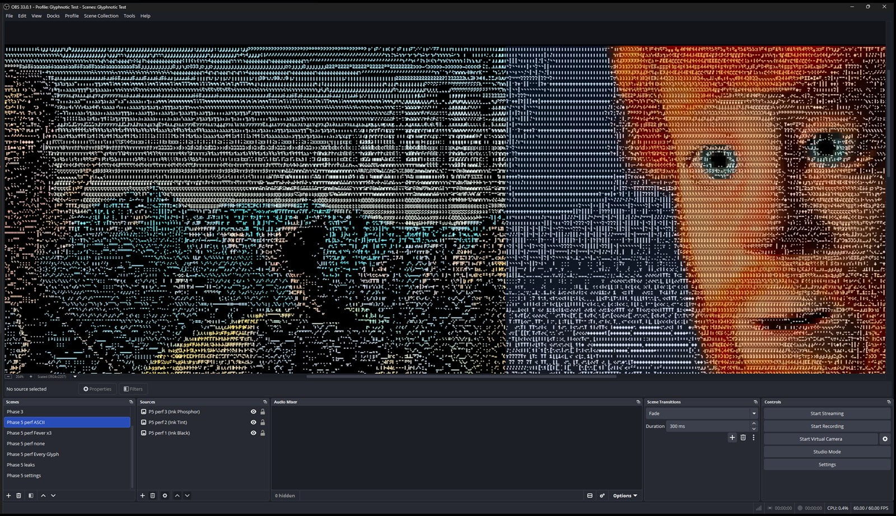
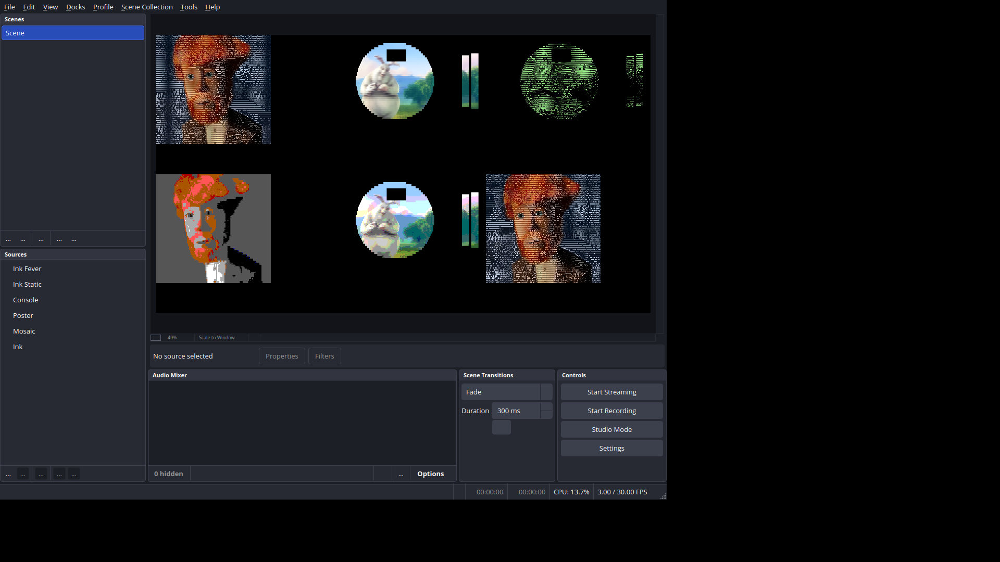

# Phase 5: performance, packaging, release

Date: 2026-11-11. Plugin version 1.0.0. Built against OBS Studio 33.0.1.

## Acceptance

| Item | Result |
| --- | --- |
| `docs/PERFORMANCE.md`: GPU time per look at 1920×1080, with the test GPU named | **Done.** OBS's source profiler (libobs GPU timer queries) through the harness, on an RTX 4070 Ti with Direct3D 11: Ink's ASCII looks 1.25–1.32 ms per frame, Static 1.51, Fever 1.66, Every Glyph 4.01, Blocks, Poster and Console 1.16–1.17. Also cell scales, character sets, instance counts, OpenGL's lagged frames and OBS's render-time stat with and without filters. |
| At 1920×1080, 60 fps: three Ink/ASCII instances on three sources with no lagged or skipped frames; one Every Glyph instance the same | **Done.** OBS 33.0.1 recording with NVENC for 60 s: Ink Black, Tint and Phosphor on three 1080p images, 3616 frames drawn, 0 lagged, 0 skipped; Every Glyph on one, 3614 drawn, 0 and 0. Three Fever instances (not asked) also 0 and 0. |
| Adding and removing a filter 100 times leaves "Number of memory leaks: 0" | **Done.** 100 times in OBS's Filters window (+, the filter, OK; select it, −, Yes; Ink, Mosaic, Poster and Console in turn), driven by Windows UI Automation and the mouse: OBS logged 100 adds and 100 removes and "Number of memory leaks: 0". Also 400 times through the API from a Lua script (each filter 100 times): 0. |
| Settings survive an OBS restart; instances on different sources stay independent | **Done.** Three filters on three sources set as the properties window sets them (Ink with custom characters, custom ink, Tint, Gamma 1.2, Hold 60, Soften 1, cell scale 2, top-left, transparent edges; Console with a captured palette, ASCII, Hold 40, Settle 50; Poster with Levels 3, cell scale 3). After quitting and restarting OBS, every filter's settings were identical and each source's screenshot pixel-identical. Changing one filter's look changed only that source's settings and picture. |
| Windows installer and zip, Linux .deb and tarball, macOS .pkg from CI; install and uninstall tested on Windows and Linux by following Install exactly | **Done after the review's push** (commit `a755cc5`). CI built every package: on the push to `main` (run 43149732497) the Windows zip and installer and the Linux .deb and tarball, and on a manual run (43149744182) the same plus `glyphnotic-1.0.0-macos-universal.pkg` (not tested: macOS may work). CI's installer installed to `C:\ProgramData\obs-studio\plugins\glyphnotic\` and registered "Glyphnotic (OBS Studio plugin)" 1.0.0 under Installed apps; OBS loaded it with all 20 test filters and 0 leaks; its uninstaller removed the folder and the entry, and OBS then started without it, keeping the filters. CI's zip, unzipped as Install says, loaded the same. CI's .deb and tarball passed all 27 checks of `install-check.sh`. Before the push the same tests ran on locally built packages (below). |
| `README.md` and `docs/INSTALL.md` final; `v1.0.0` tagged with a GitHub Release | **Partly.** README and INSTALL are final, the version is 1.0.0, and CI now makes a draft release for a `v1.0.0` tag. The tag and the release are publishing steps, left for after the review. |

**License, decided at the review: GPL-2.0-or-later**, added before the
tag so 1.0.0's source and packages carry it: the root `LICENSE` (GPL
version 2 text), installed with the plugin's data in every package; an SPDX
header and copyright line on Glyphnotic's own source and effect files; the
README's and spec's licensing sections. Also before the tag: the logo
(`docs/images/glyphnotic-logo.svg`, with a white background so it reads on
dark themes) and a Ko-fi link in the README and `.github/FUNDING.yml`.

**Released:** commit `38c8674` (CI green, every package carrying
`LICENSE`) was tagged `v1.0.0`. The tag's run (43162285670) built every
platform in the Release configuration and created the draft release
"Glyphnotic 1.0.0" with seven files: the Windows installer and zip, the
Linux .deb, debug symbols and tarball, the macOS .pkg and the source
tarball, each checksum in the notes matching the downloaded file. The
release's zip, installed in place of the test install, ran three ASCII
instances at 1080p60 with no lagged or skipped frames and 400 filters added
and removed with 0 leaks; its .deb and tarball passed all 27 Linux install
checks. It stays a draft until it's published.

## What was built

- **Version 1.0.0** in `buildspec.json` (the manifest, the .deb and the
  package names follow).
- **Windows installer**: `cmake/windows/resources/installer-Windows.iss`
  (Inno Setup 6). It installs only to
  `C:\ProgramData\obs-studio\plugins\glyphnotic\`, with no folder page,
  needs administrator rights, registers "Glyphnotic (OBS Studio plugin)"
  under Installed apps, and has a fixed `AppId` so upgrades replace the
  earlier install; it asks to close OBS if OBS holds the plugin open.
  `Package-Windows.ps1 -BuildInstaller` compiles it after the zip.
- **CI** (`.github/`): when CI packages (pushes to `main`, tags, and now
  manual runs) the Windows job installs Inno Setup with Chocolatey if needed
  and builds the installer; manual runs package too, so the macOS .pkg can
  be built before a tag; release tags may be `v1.0.0` (the template accepted
  only `1.0.0`), the release job checks the tag against `buildspec.json`'s
  version and creates the draft release on the tag itself.
- **Linux tarball**: its `glyphnotic.so` is now stripped like the .deb's
  (Phase 0 noted 211 KB against 26 KB).
- **Tools** (none shipped):
  - `tools/reference/run_performance.py`: the GPU-time suites.
  - `tools/obs-tests/run_obs_tests.py`, `glyphnotic-tests.lua`,
    `filters-ui.ps1`: the tests in the OBS window (performance at 1080p60,
    leaks through the Filters window and the API, settings across a
    restart). The driver backs up the test collection and profile, sets the
    profile to 1080p60, adds its scenes and the script, and starts OBS once
    per test.
  - `tools/linux-check/install-check.sh`: the Linux install test.
- **Docs**: `docs/PERFORMANCE.md` (new), final `README.md` and
  `docs/INSTALL.md` (release files, the installer, uninstalling, upgrading,
  portable OBS), `docs/BUILDING.md` (the installer, making a release),
  `tools/README.md`, `docs/BUILDER-NOTES.md`.

No plugin code changed in this phase.

## How it was tested

Machine as in Phases 1–4: Windows 11 Pro 25H2, NVIDIA GeForce RTX 4070 Ti
(driver 621.01), OBS 33.0.1, Docker Desktop 29.8.0.

### Performance

`run_performance.py` on both renderers; `docs/PERFORMANCE.md` has the
tables and the method. The first version timed one instance alone and gave
1.8–3.0 ms for the same filter in different runs; timed as three instances
in one scene, per-instance figures are steady and the scene's time grows
linearly with the count, so that's the method. On OBS's OpenGL renderer the
source profiler reported 0 GPU time throughout, so OpenGL has only
lagged-frame counts (Every Glyph lags with three 1080p instances at 60 fps,
not with two).

### In the OBS window

`run_obs_tests.py` with OBS 33.0.1, the test collection and profile only,
after backups (`D:\Repos\Glyphnotic_backups\2026-11-11 before Phase 5 tests
- Glyphnotic_Test.json` and `- profile basic.ini`). The profile now runs
at 1920×1080 base and output, 60 fps (it was 1280×720 output at 30 fps).
The plugin was installed from the 1.0.0 zip.

| Test | Result |
| --- | --- |
| perf-ascii (Ink Black, Tint, Phosphor on three 1080p images, 60 s recording) | 3616 drawn, 0 lagged, 0 skipped; render time 0.369 ms |
| perf-every (Every Glyph on one) | 3614 drawn, 0 lagged, 0 skipped; 0.313 ms |
| perf-fever (Fever on three) | 3615 drawn, 0 lagged, 0 skipped; 0.368 ms |
| perf-none (the three images, no filter) | 3615 drawn, 0 lagged, 0 skipped; 0.254 ms |
| leak-ui (100 filters through the Filters window, no script loaded) | 100 adds and 100 removes logged, 0 leaks |
| leak (400 filters through the API) | 0 leaks |
| persist (set, restart, check, change one) | all 15 checks pass |

Every run logged no Glyphnotic errors or warnings and 0 leaks.

### Install and uninstall

**Windows, the zip, following Install:** with OBS closed, the earlier test
install was moved aside (to `_trash`, not deleted) and
`glyphnotic-1.0.0-windows-x64.zip` unzipped into
`C:\ProgramData\obs-studio\plugins\`; OBS loaded Glyphnotic 1.0.0 from
there (Plugin Manager's `modules.json`: version 1.0.0, all four filters)
and every test above ran on it. Uninstall: the folder moved out; OBS
started without loading it, with 0 leaks, and kept all 20 Glyphnotic filters
in the saved collection; unzipped again, all 20 loaded with their settings.
The zip was made with Windows PowerShell 5.1's `Compress-Archive`, as
`Package-Windows.ps1` does under PowerShell 7 in CI.

**Linux, the .deb and the tarball, following Install**
(`install-check.sh`, Ubuntu 26.04 container, OBS 33.0.0 from the PPA,
packages built with CI's `build-ubuntu` and `package-ubuntu --package`):
`sudo apt install ./glyphnotic-1.0.0-linux-x86_64.deb` (84 KB), OBS loaded
1.0.0 and created the filter with no errors and 0 leaks; `sudo apt remove
glyphnotic` removed both folders, OBS didn't load it and kept the filter
and its look in the collection. The tarball (69 KB, `.so` stripped)
extracted into `~/.local/share/obs-studio/plugins` gave the same, and
deleting its folder the same. All 27 checks pass.

### Linux check

**Passed** on the first run: OBS 33.0.0 under `xvfb-run` on Mesa llvmpipe,
the plugin built with GCC (warnings as errors), unit tests passing, each
filter created, no errors, no failed draws, clean shutdown, 0 leaks.

### CI

A manual run on Phase 4's commit (`6c5741e`, run 43135013993) passed on
Windows, Ubuntu and, for the first time, macOS (2 minutes). This phase's CI
changes haven't run yet.

### Unit tests and formatting

The four unit test programs pass with MSVC (and GCC in the Linux check).
clang-format and gersemi report no changes.

## Findings

1. **OBS 33.0.1 leaks by itself with `--disable-missing-files-check`**:
   started with that flag, OBS logs "Number of memory leaks: 1" with or
   without Glyphnotic's filters in the scene; without it, 0. It cost a
   bisection (collection, profile, scripts, plugin build) to find. The test
   driver doesn't use it.
2. **A Lua script that registers a frontend event callback must not call
   waiting frontend functions from `script_tick`**: switching scenes from
   the tick (OBS's graphics thread) waits for the UI thread, which waits
   for the script's lock to deliver the scene-change event, and OBS hangs.
   The test script polls instead.
3. **A lone filter's GPU time is noisy**, 1.3–2× its cost under load; see
   `docs/PERFORMANCE.md`.
4. **The cost is in the full-resolution passes, not the glyph count**,
   except for Every Glyph: Blocks, Lines and ASCII cost within 0.3 ms of
   each other, and cell scale 2× halves Every Glyph's cost.
5. **OpenGL issues each filter's passes with 12× Direct3D's CPU time** (0.6
   against 0.05 ms per frame) and is slower on the GPU: three Every Glyph
   instances lag at 1080p60 there, not on Direct3D.
6. **OBS keeps filters whose plugin is missing**, with their settings, and
   restores them when the plugin returns, on both platforms; INSTALL.md
   now says so.
7. **Qt's accessibility tree changes under UI Automation**: element handles
   go stale and a click can land mid-layout, so `filters-ui.ps1` looks
   every control up again and retries a click whose result doesn't appear.

## Deviations from the spec, with reasons

- **The installer was first built by CI**: Inno Setup isn't installed on
  the test machine (installing it means downloading software, which wasn't
  asked for). CI's build was tested after the review's push, in silent mode
  (`/SILENT`; the only prompt was Windows' administrator prompt), and so
  was its uninstaller.
- **The tag and the release wait for the license** (decided at the
  review).
- **Release tags are `v<version>`**: the spec says `v1.0.0`; the template's
  release job only knew `1.0.0`, so it was changed rather than the tag.
- **macOS package name** stays the template's
  `glyphnotic-<version>-macos-universal.pkg` (Phase 0 noted it); the spec's
  Install section now uses it.
- **Manual CI runs now package** (the template's didn't), so the macOS .pkg
  can be built and the installer tried before tagging; the spec's "macOS
  builds only for tags and manual runs" is unchanged.
- **The performance method**: three instances in a scene, divided by
  three, rather than one instance alone, which reads high and noisy.

## To try

- After the push, run CI's installer on Windows: it should ask for
  administrator rights, install without asking for a folder, and show up as
  "Glyphnotic (OBS Studio plugin)" under Installed apps; uninstall from
  there with OBS closed.
- Put three Ink instances on real 1080p60 cameras and open **View → Stats**:
  "Frames missed due to rendering lag" should stay at 0.
- Glance at `docs/PERFORMANCE.md` and `README.md` as a newcomer would.

## Open questions

- **Install Inno Setup on this machine?** It would let the installer be
  built and tested before a push (`winget install JRSoftware.InnoSetup`, or
  from jrsoftware.org). Without it, CI's build is the first.
- **The installer isn't code-signed**, so SmartScreen warns on a downloaded
  copy (INSTALL.md says what to do). Signing needs a certificate, which
  costs money.
- **The release is a draft** in a private repository: publish it as soon
  as it's checked, or keep it a draft until the license is decided?
- **The test profile now runs at 1080p60** (the backup has the old one).
  **Decided at the Phase 5 review: it stays at 1080p60.**

## Spec updates made

- Status: v1.0 built in Phases 0–5.
- Repository layout: the installer script, `tools/obs-tests/`, the Linux
  install test.
- Install, macOS: the package's real name.
- Phase 5 boxes: the four done are ticked; packaging and the release say
  what remains.
